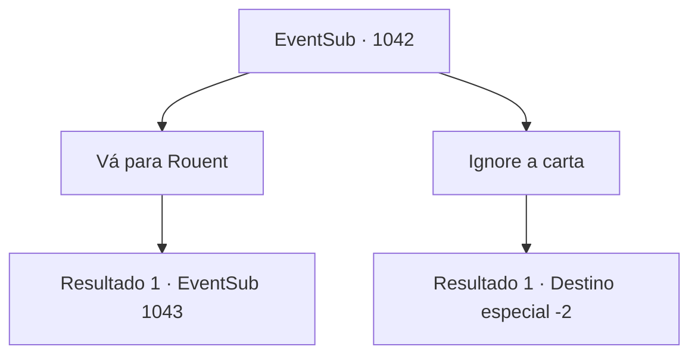

# Eventos secundários · 1042

[Índice da tabela](index.md) · [Índice geral](../index.md)

ID: `pt:EventSub:1042` · Fonte: `EventSub4` · Versão: 1.2.47.

Mapeamento estático dos arquivos; a disponibilidade e a execução dependem do estado da run.

## Texto do evento

Um pombo voa ruidosamente em sua direção. Amarrado em seu pescoço está um lenço inscrito com um tridente azul - o símbolo da Casa Ronan. Você estende o braço, para que o pombo possa pousar sobre ele. 

 "Coo coo... coo coo."

 O pombo se acomoda. Cuidadosamente, você desamarra a carta presa em seus pés. A carta é de Lupin.
 'Encontre-me na ponte sobre o rio em Rouent, a capital do Condado de Ronan. Avisarei os guardas com antecedência.'
 Tendo completado sua missão, o pombo abre as asas novamente e alça voo. Você silenciosamente o observa voar para longe no céu.

## Dados de entrada

```json
{
  "id": 1042,
  "grade": 1,
  "subEvent": "",
  "required": "12_12_2|1_2_40"
}
```

## Mapa das escolhas



## Escolhas e resultados

### Escolha 1

Vá para Rouent

Requisitos e outros campos da escolha:

```json
{
  "required": ""
}
```

#### Resultado 1.1

|drawing_Rouent| Após alguns dias de viagem, você chega à cidade capital do Condado de Ronan, 'Rouent'. Os guardas da cidade imediatamente reconhecem seu rosto e o deixam entrar sem inspeção. Ao passar pelas grossas muralhas da cidade, uma rua principal bem polida, pontilhada de edifícios coloridos, o recebe. Você segue a rua principal, tentando encontrar a ponte que Lupin mencionou. Um rio, com cerca de trinta metros de largura, atravessa o coração da cidade. Você caminha até a ponte sobre o grande riacho e espera por Lupin lá.  Alguns momentos depois, enquanto você observa as trutas saltarem para cima e para baixo na água, um cavaleiro familiar se aproxima de você. Ele acena com as mãos para cumprimentá-lo, depois vai direto ao ponto. 

 "O Conde está esperando por você. Vamos."

 Lupin o leva à sala de audiências do castelo, onde o Conde está esperando.  A pesada porta se abre. Você entra no salão espaçoso. Paredes de pedra fria cobrem a área, com um lustre de ferro pendurado no teto, emitindo uma luz tênue. No final do salão há uma fundação elevada, no topo da qual estão três cadeiras luxuosas. Sentado na cadeira central está ninguém menos que o próprio Conde Ronan. Nas duas cadeiras ao redor do Conde devem estar suas esposas. Uma parece ter a mesma idade do Conde, com cabelos branco-prateados e olhos vermelhos como rubi que lembram você de Edward. A outra, com cabelos loiros e encaracolados, está, a julgar pelo tamanho de sua barriga, grávida. Ela parece muito mais jovem que o Conde. Você percebe que o Conde tem seu olhar fixo em você. 

 "Ouvi dizer que você é a pessoa a quem devo agradecer por salvar meu filho Edward. Do fundo do meu coração, eu agradeço."

 Ele lhe entrega um baú cheio de ouro, acrescentando que gostaria de compensá-lo oficialmente por seus problemas. Ele deseja também estender sua hospitalidade - você teria permissão para um breve descanso e uma boa refeição.

Continuação registrada: [Evento 1043](1043.md) na mesma tabela.

```json
{
  "required": "",
  "chance": "1",
  "nextEvent": 1043,
  "type": 2,
  "reward": ""
}
```

### Escolha 2

Ignore a carta

Requisitos e outros campos da escolha:

```json
{
  "required": ""
}
```

#### Resultado 2.1

Você ignora a carta de Lupin.

Continuação registrada: [Destino especial `-2`](../destinos-especiais.md).

```json
{
  "required": "",
  "chance": "1",
  "nextEvent": -2,
  "type": 2,
  "reward": "12_12_-1"
}
```

## Referências que chegam a este evento

Nenhum `nextEvent` positivo da mesma tabela aponta para este nó. Isso não prova que seja inacessível: sorteio e estado de história podem selecioná-lo.

