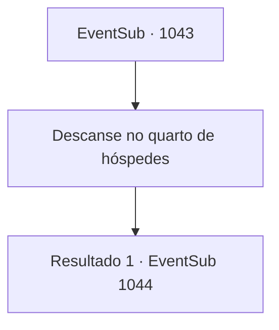

# Eventos secundários · 1043

[Índice da tabela](index.md) · [Índice geral](../index.md)

ID: `pt:EventSub:1043` · Fonte: `EventSub4` · Versão: 1.2.47.

Mapeamento estático dos arquivos; a disponibilidade e a execução dependem do estado da run.

## Texto do evento

*Sem texto no arquivo.*

## Dados de entrada

```json
{
  "id": 1043,
  "grade": 1,
  "subEvent": "",
  "required": ""
}
```

## Mapa das escolhas



## Escolhas e resultados

### Escolha 1

Descanse no quarto de hóspedes

Requisitos e outros campos da escolha:

```json
{
  "required": ""
}
```

#### Resultado 1.1

O mordomo pessoal do Conde leva você ao quarto de hóspedes. Logo, a Condessa entra na sala. Ela tem um impressionante cabelo prateado. Ela começa a falar, dizendo que tem um pedido para você. 

 "Devo primeiro agradecer por encontrar e trazer Edward de volta para nós. Meu nome é Irema Ronan. Esposa do Conde Ronan e mãe de Edward. Apesar de tudo que você fez por nossa família, {1}, devo pedir-lhe mais um favor."

 Segundo ela, a saúde de Edward não se recuperou nas últimas semanas. Ela acrescenta que alguém deve estar deliberadamente piorando as condições de Edward. 

 "Percorremos todo o reino em busca de remédios e ingredientes saudáveis. No entanto, ele está definhando a cada dia. Suponho que você entenda o quanto estamos preocupados. Alguém... deve estar atrás da vida de Edward, temo."


Continuação registrada: [Evento 1044](1044.md) na mesma tabela.

```json
{
  "required": "",
  "chance": "1",
  "nextEvent": 1044,
  "type": 2,
  "reward": "0_4_200"
}
```

## Referências que chegam a este evento

- [Evento 1042 · escolha 1 · resultado 1](1042.md#escolha-1)
