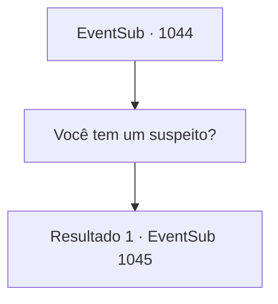

# Eventos secundários · 1044

[Índice da tabela](index.md) · [Índice geral](../index.md)

ID: `pt:EventSub:1044` · Fonte: `EventSub4` · Versão: 1.2.47.

Mapeamento estático dos arquivos; a disponibilidade e a execução dependem do estado da run.

## Texto do evento

*Sem texto no arquivo.*

## Dados de entrada

```json
{
  "id": 1044,
  "grade": 1,
  "subEvent": "",
  "required": ""
}
```

## Mapa das escolhas



## Escolhas e resultados

### Escolha 1

Você tem um suspeito?

Requisitos e outros campos da escolha:

```json
{
  "required": ""
}
```

#### Resultado 1.1

Irema consegue elaborar uma lista de suspeitos. 

 "Hm... as únicas pessoas que podem afetar diretamente Edward são..."

 O Chef de Cozinha que tem preparado a comida de Edward há anos. O jovem médico da corte que foi contratado recentemente. As empregadas que cuidam de Edward. Irema suspeita que alguém da lista deve estar afetando negativamente o bem-estar de Edward.

Continuação registrada: [Evento 1045](1045.md) na mesma tabela.

```json
{
  "required": "",
  "chance": "1",
  "nextEvent": 1045,
  "type": 2,
  "reward": ""
}
```

## Referências que chegam a este evento

- [Evento 1043 · escolha 1 · resultado 1](1043.md#escolha-1)
