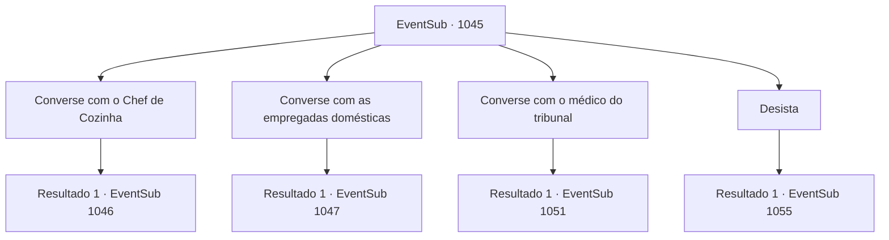

# Eventos secundários · 1045

[Índice da tabela](index.md) · [Índice geral](../index.md)

ID: `pt:EventSub:1045` · Fonte: `EventSub4` · Versão: 1.2.47.

Mapeamento estático dos arquivos; a disponibilidade e a execução dependem do estado da run.

## Texto do evento

*Sem texto no arquivo.*

## Dados de entrada

```json
{
  "id": 1045,
  "grade": 1,
  "subEvent": "",
  "required": ""
}
```

## Mapa das escolhas



## Escolhas e resultados

### Escolha 1

Converse com o Chef de Cozinha

Requisitos e outros campos da escolha:

```json
{
  "required": "5_810_0"
}
```

#### Resultado 1.1

Você se dirige à cozinha do castelo. A equipe da cozinha já está ocupada preparando as refeições. O Chef Principal é um anão, ocupado preparando os ingredientes. Assim que ele está prestes a passar para o frango, ele sente sua presença e olha para você. 

 "Ah. O aventureiro que salvou a vida do Jovem Mestre. O que o traz aqui?"

 Você aponta que a saúde de Edward tem piorado a cada dia. Você pergunta se poderia haver algo de errado com a comida dele, ao que o cozinheiro anão responde balançando a cabeça. 

 "O Jovem Mestre está enfraquecendo a cada dia. Estou ciente. Naturalmente, esperava que a Condessa suspeitasse de mim. Ela é uma mulher de sabedoria e perspicácia, afinal. Você está convidado a inspecionar a cozinha. Pode até verificar o porão também."

 O Chef Principal abre a porta para você com confiança, como se esta fosse a oportunidade perfeita para provar sua inocência. 

 "Aqui. Entre."


Continuação registrada: [Evento 1046](1046.md) na mesma tabela.

```json
{
  "required": "",
  "chance": "1",
  "nextEvent": 1046,
  "type": 2,
  "reward": "5_810_1"
}
```

### Escolha 2

Converse com as empregadas domésticas

Requisitos e outros campos da escolha:

```json
{
  "required": "5_811_0"
}
```

#### Resultado 2.1

Você se dirige aos aposentos das empregadas. Elas trabalham em turnos - as empregadas fora de serviço estão fazendo uma pausa lá, conversando e fofocando. Assim que você entra na sala, elas se levantam de suas camas e o cumprimentam educadamente. A mais velha das empregadas é a primeira a falar. 

 "Este lugar não está equipado para acomodar convidados... Como podemos ser úteis?"

 Você aponta que a saúde de Edward está piorando a cada dia. Você exige que as empregadas lhe contem tudo o que sabem. Mas elas simplesmente ficam ali rígidas e em silêncio, observando as expressões umas das outras.

Continuação registrada: [Evento 1047](1047.md) na mesma tabela.

```json
{
  "required": "",
  "chance": "1",
  "nextEvent": 1047,
  "type": 2,
  "reward": "5_811_1"
}
```

### Escolha 3

Converse com o médico do tribunal

Requisitos e outros campos da escolha:

```json
{
  "required": "5_812_0"
}
```

#### Resultado 3.1

Você vai para o quarto do médico da corte. Ele está lendo um livro, sentado em uma poltrona confortável. Assim que ele te vê, ele levanta as sobrancelhas em resposta. 

 "Mm? Quem é você?"

 Você aponta que a saúde de Edward tem piorado a cada dia. O médico suspira. 

 "*suspiro*... Ei. O que você sabe sobre a saúde do Jovem Mestre, hm? Você realmente acha que um aventureiro pode me dar uma lição sobre isso?"


Continuação registrada: [Evento 1051](1051.md) na mesma tabela.

```json
{
  "required": "",
  "chance": "1",
  "nextEvent": 1051,
  "type": 2,
  "reward": "5_812_1"
}
```

### Escolha 4

Desista

Requisitos e outros campos da escolha:

```json
{
  "required": ""
}
```

#### Resultado 4.1

Você desiste da sua investigação e retorna ao quarto de hóspedes. Lá, você se encontra com Irema. Graciosamente tomando chá na mesa, ela se vira e percebe você. 

 "Você voltou. Temos uma pista?"


Continuação registrada: [Evento 1055](1055.md) na mesma tabela.

```json
{
  "required": "",
  "chance": "1",
  "nextEvent": 1055,
  "type": 2,
  "reward": ""
}
```

## Referências que chegam a este evento

- [Evento 1044 · escolha 1 · resultado 1](1044.md#escolha-1)
- [Evento 1046 · escolha 1 · resultado 1](1046.md#escolha-1)
- [Evento 1046 · escolha 1 · resultado 2](1046.md#escolha-1)
- [Evento 1047 · escolha 3 · resultado 1](1047.md#escolha-3)
- [Evento 1049 · escolha 1 · resultado 1](1049.md#escolha-1)
- [Evento 1050 · escolha 1 · resultado 1](1050.md#escolha-1)
- [Evento 1050 · escolha 1 · resultado 2](1050.md#escolha-1)
- [Evento 1050 · escolha 1 · resultado 3](1050.md#escolha-1)
- [Evento 1050 · escolha 2 · resultado 1](1050.md#escolha-2)
- [Evento 1050 · escolha 3 · resultado 1](1050.md#escolha-3)
