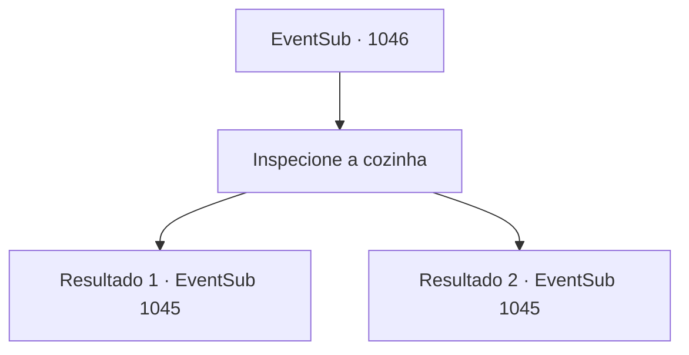

# Eventos secundários · 1046

[Índice da tabela](index.md) · [Índice geral](../index.md)

ID: `pt:EventSub:1046` · Fonte: `EventSub4` · Versão: 1.2.47.

Mapeamento estático dos arquivos; a disponibilidade e a execução dependem do estado da run.

## Texto do evento

*Sem texto no arquivo.*

## Dados de entrada

```json
{
  "id": 1046,
  "grade": 1,
  "subEvent": "",
  "required": ""
}
```

## Mapa das escolhas



## Escolhas e resultados

### Escolha 1

Inspecione a cozinha

Requisitos e outros campos da escolha:

```json
{
  "required": ""
}
```

#### Resultado 1.1

Você inspeciona cuidadosamente a cozinha. No canto está um gato - provavelmente aqui para caçar os roedores - que está te encarando com olhos brilhantes. A cozinha é mantida limpa. Até as ferramentas usadas no cozimento, como a tábua de corte e as facas, são mantidas em ótimo estado e organizadas ordenadamente ao longo das paredes. Depois de visitar a cozinha, você se dirige à área de armazenamento. Legumes frescos e carnes secas com segurança estão todos bem categorizados e organizados. Nem um único rato à vista. O Chef Principal organiza seu cabelo e barba, depois cruza os braços com orgulho. 

 "Já viu uma cozinha em melhor condição?"

 Ele está certo - você não percebe nada estranho na cozinha. Você decide verificar as outras áreas e sai da cozinha.

Continuação registrada: [Evento 1045](1045.md) na mesma tabela.

```json
{
  "required": "18_792_1",
  "chance": "1",
  "nextEvent": 1045,
  "type": 2,
  "reward": ""
}
```

#### Resultado 1.2

Você inspeciona cuidadosamente a cozinha. Lá, você encontra Erina, que está ajudando como aprendiz. 

 "Oh! Oi! Faz tanto tempo, né?!"

 Ela alegremente sai da cozinha e começa a explicar em detalhes sobre o lugar. Com Erina como sua guia, você faz um tour pela cozinha. Está bem mantida e limpa. Até as ferramentas usadas na cozinha, como a tábua de corte e as facas, estão em ótimo estado e organizadas cuidadosamente ao longo das paredes. Depois de visitar a cozinha, você vai para a área de armazenamento. Legumes frescos e carnes secas com segurança estão todos bem categorizados e organizados. Nem um único rato à vista. O Chef Principal organiza seu cabelo e barba, depois cruza os braços orgulhosamente. 

 "Já viu uma cozinha em melhor condição?"

 Ele está certo - você não percebe nada estranho na cozinha. Você decide verificar as outras áreas e sai da cozinha.

Continuação registrada: [Evento 1045](1045.md) na mesma tabela.

```json
{
  "required": "5_792_1",
  "chance": "1",
  "nextEvent": 1045,
  "type": 2,
  "reward": ""
}
```

## Referências que chegam a este evento

- [Evento 1045 · escolha 1 · resultado 1](1045.md#escolha-1)
