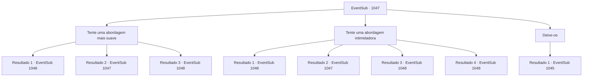

# Eventos secundários · 1047

[Índice da tabela](index.md) · [Índice geral](../index.md)

ID: `pt:EventSub:1047` · Fonte: `EventSub4` · Versão: 1.2.47.

Mapeamento estático dos arquivos; a disponibilidade e a execução dependem do estado da run.

## Texto do evento

*Sem texto no arquivo.*

## Dados de entrada

```json
{
  "id": 1047,
  "grade": 1,
  "subEvent": "",
  "required": ""
}
```

## Mapa das escolhas



## Escolhas e resultados

### Escolha 1

Tente uma abordagem mais suave

Requisitos e outros campos da escolha:

```json
{
  "required": "5_813_0"
}
```

#### Resultado 1.1

Você fala com as empregadas gentilmente, baixando a guarda delas com um discurso fluente. Uma das empregadas decide falar. 

 "H- Helen ali. Ela tem algo estranho com ela."

 Todos na sala se voltam para essa 'Helen'. Helen, com os olhos tremendo de medo, se vira para você e fala. 

 "E- esse é o meu remédio!"


Continuação registrada: [Evento 1048](1048.md) na mesma tabela.

```json
{
  "required": "18_814_9",
  "chance": "1|0_12_1",
  "nextEvent": 1048,
  "type": 0,
  "reward": "5_813_1"
}
```

#### Resultado 1.2

Você fala gentilmente com as empregadas, tentando baixar a guarda delas com um discurso fluente. Sua abordagem falha drasticamente - ainda mais cautelosas do que antes, as empregadas se afastam lentamente de você. 

 "N- nós não sabemos de nada..."


Continuação registrada: [Evento 1047](1047.md) na mesma tabela.

```json
{
  "required": "18_814_9",
  "chance": "18",
  "nextEvent": 1047,
  "type": 1,
  "reward": "5_813_9"
}
```

#### Resultado 1.3

Você fala com as empregadas gentilmente, desta vez tentando baixar a guarda delas com um discurso fluente. Você também acrescenta que está fazendo tudo isso por causa de Edward. A mais velha das empregadas acena em resposta. 

 "Entendo. Se for esse o caso, você terá nossa cooperação."

 Uma das empregadas decide falar. 

 "H- a Helen ali. Ela tem algo estranho com ela."

 Todos na sala se viram para essa 'Helen'. Helen, com os olhos tremendo de medo, se vira para você e fala. 

 "E- esse é o meu remédio!"


Continuação registrada: [Evento 1048](1048.md) na mesma tabela.

```json
{
  "required": "5_814_9",
  "chance": "1",
  "nextEvent": 1048,
  "type": 2,
  "reward": ""
}
```

### Escolha 2

Tente uma abordagem intimidadora

Requisitos e outros campos da escolha:

```json
{
  "required": "5_814_0"
}
```

#### Resultado 2.1

Você ameaça as empregadas, ameaçando-as de que algo ruim pode acontecer se não disserem a verdade. Uma das empregadas decide falar. 

 "H- Helen está lá. Ela tem algo estranho com ela."

 Todos na sala se voltam para essa 'Helen'. Helen, com os olhos tremendo de medo, se vira para você e fala. 

 "E- esse é meu remédio!"


Continuação registrada: [Evento 1048](1048.md) na mesma tabela.

```json
{
  "required": "21_1_4|18_813_9",
  "chance": "1|0_12_1",
  "nextEvent": 1048,
  "type": 0,
  "reward": "5_814_1"
}
```

#### Resultado 2.2

Você ameaça as empregadas, ameaçando-as de que algo ruim pode acontecer se não disserem a verdade. A mais velha das empregadas responde. 

 "Hmph. Como se o Conde deixasse suas empregadas serem prejudicadas."

 Parece que persuadi-las a ficar do seu lado não será fácil.

Continuação registrada: [Evento 1047](1047.md) na mesma tabela.

```json
{
  "required": "21_1_4|18_813_9",
  "chance": "12",
  "nextEvent": 1047,
  "type": 1,
  "reward": "5_814_9"
}
```

#### Resultado 2.3

Você ameaça as empregadas, ameaçando-as de que algo ruim pode acontecer se não disserem a verdade. Uma das empregadas decide falar. 

 "H- Helen está lá. Ela tem algo estranho com ela."

 Todos na sala se voltam para essa 'Helen'. Helen, com os olhos tremendo de medo, se vira para você e fala. 

 "E- esse é meu remédio!"


Continuação registrada: [Evento 1048](1048.md) na mesma tabela.

```json
{
  "required": "20_1_4|18_813_9",
  "chance": "1",
  "nextEvent": 1048,
  "type": 2,
  "reward": "5_814_1"
}
```

#### Resultado 2.4

Você fala rudemente com as empregadas, desta vez ameaçando-as de que algo ruim pode acontecer se não disserem a verdade. Você também acrescenta que está fazendo tudo isso por causa de Edward. A mais velha das empregadas acena em resposta. 

 "Entendo. Se for esse o caso, você terá nossa cooperação."

 Uma das empregadas decide falar. 

 "H- a Helen ali. Ela tem algo estranho com ela."

 Todos na sala se voltam para essa 'Helen'. Helen, com os olhos tremendo de medo, se vira para você e fala. 

 "E- essa é a minha medicação!"


Continuação registrada: [Evento 1048](1048.md) na mesma tabela.

```json
{
  "required": "5_813_9",
  "chance": "1",
  "nextEvent": 1048,
  "type": 2,
  "reward": ""
}
```

### Escolha 3

Deixe-os

Requisitos e outros campos da escolha:

```json
{
  "required": "-1|5_814_9|5_813_9"
}
```

#### Resultado 3.1

Você deixa as empregadas e volta para o corredor. Elas te olham com cautela, só voltando para seus aposentos quando você já passou pela esquina.

Continuação registrada: [Evento 1045](1045.md) na mesma tabela.

```json
{
  "required": "",
  "chance": "1",
  "nextEvent": 1045,
  "type": 2,
  "reward": ""
}
```

## Referências que chegam a este evento

- [Evento 1045 · escolha 2 · resultado 1](1045.md#escolha-2)
- [Evento 1047 · escolha 1 · resultado 2](1047.md#escolha-1)
- [Evento 1047 · escolha 2 · resultado 2](1047.md#escolha-2)
