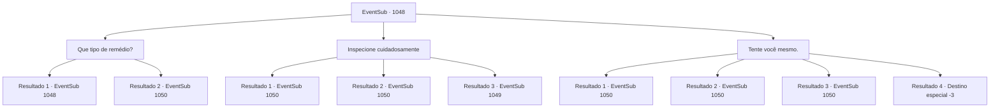

# Eventos secundários · 1048

[Índice da tabela](index.md) · [Índice geral](../index.md)

ID: `pt:EventSub:1048` · Fonte: `EventSub4` · Versão: 1.2.47.

Mapeamento estático dos arquivos; a disponibilidade e a execução dependem do estado da run.

## Texto do evento

*Sem texto no arquivo.*

## Dados de entrada

```json
{
  "id": 1048,
  "grade": 1,
  "subEvent": "",
  "required": ""
}
```

## Mapa das escolhas



## Escolhas e resultados

### Escolha 1

Que tipo de remédio?

Requisitos e outros campos da escolha:

```json
{
  "required": "5_815_0"
}
```

#### Resultado 1.1

Helen hesita um pouco antes de responder a você. 

 "Eu tenho... tido alguns problemas digestivos recentemente. Então pedi a 'Paldianos' alguns analgésicos."

 Ela acrescenta que 'Paldianos' é o nome do médico da corte.

Continuação registrada: [Evento 1048](1048.md) na mesma tabela.

```json
{
  "required": "21_1_4",
  "chance": "1",
  "nextEvent": 1048,
  "type": 2,
  "reward": "5_815_1"
}
```

#### Resultado 1.2

Helen começa a tremer como um paciente em espasmos. 

 "E- Eu consegui de 'Paldianos'!"

 Seu rosto está pálido. Ela acrescenta, como se estivesse pensando em uma desculpa. 

 "E- Eu não tive escolha! O médico tinha laços estreitos com a Sra. Hazel, e eu simplesmente não podia dizer não...!"

 Sua voz começa a tremer. Seus olhos estão tremendo de medo. 

 "Além disso... Eu não sou a única que fez isso!"

 Infelizmente, Helen cai no chão e começa a chorar.

Continuação registrada: [Evento 1050](1050.md) na mesma tabela.

```json
{
  "required": "20_1_4",
  "chance": "1",
  "nextEvent": 1050,
  "type": 2,
  "reward": "5_816_1"
}
```

### Escolha 2

Inspecione cuidadosamente

Requisitos e outros campos da escolha:

```json
{
  "required": "5_817_0"
}
```

#### Resultado 2.1

Você passa rapidamente por seus conhecimentos de botânica e se lembra com sucesso de que isso é veneno em pó. É feito moendo uma planta venenosa chamada 'Cachoeira do Diabo' - que recebeu esse nome pela dor de estômago extrema e a diarreia explosiva que causa em quem a consome. Você imediatamente pergunta a Helen de onde ela conseguiu o pó. Ela responde que conseguiu de uma botica local. A empregada mais velha repreende Helen. 

 "VENENO?! É melhor você ter uma boa explicação para isso, Helen. Caso contrário, vou notificar o Conde e fazer com que você seja julgada por traição!"

 O rosto de Helen está pálido. Ela acrescenta, como se estivesse pensando em uma desculpa. 

 "E-eu não tive escolha! O médico tinha ligações estreitas com a Sra. Hazel, e eu simplesmente não pude dizer não...!"

 Sua voz começa a tremer. Seus olhos estão tremendo de medo. 

 "Além disso... eu não fui a única que fez isso!"

 Por fim, Helen desaba no chão e começa a chorar.

Continuação registrada: [Evento 1050](1050.md) na mesma tabela.

```json
{
  "required": "",
  "chance": "1|0_7_1",
  "nextEvent": 1050,
  "type": 0,
  "reward": "5_817_1"
}
```

#### Resultado 2.2

Você instintivamente percebe que isso é veneno em pó. Você imediatamente pergunta a Helen de onde ela conseguiu o pó. Ela responde que conseguiu de um boticário local. A empregada mais velha repreende Helen. 

 "VENENO?! É melhor você ter uma boa explicação para isso, Helen. Caso contrário, vou notificar o Conde e fazer com que você seja julgada por traição!"

 O rosto de Helen está pálido. Ela acrescenta, como se estivesse pensando em uma desculpa. 

 "E-eu não tive escolha! O médico tinha ligações próximas com a Sra. Hazel, e eu simplesmente não pude dizer não...!"

 Sua voz começa a tremer. Seus olhos estão tremendo de medo. 

 "Além disso... eu não sou a única que fez isso!"

 Infelizmente, Helen cai no chão e começa a chorar.

Continuação registrada: [Evento 1050](1050.md) na mesma tabela.

```json
{
  "required": "",
  "chance": "1|0_14_1",
  "nextEvent": 1050,
  "type": 0,
  "reward": "5_817_1"
}
```

#### Resultado 2.3

Você inspeciona cuidadosamente o pó branco. Mas não encontra nada de valor, além de sua cor e textura. Helen verifica você cuidadosamente, antes de lhe dizer que conseguiu de um boticário local.

Continuação registrada: [Evento 1049](1049.md) na mesma tabela.

```json
{
  "required": "",
  "chance": "30",
  "nextEvent": 1049,
  "type": 1,
  "reward": "5_817_9"
}
```

### Escolha 3

Tente você mesmo.

Requisitos e outros campos da escolha:

```json
{
  "required": ""
}
```

#### Resultado 3.1

Você despeja o pó na boca. Os olhos de Helen se arregalam enquanto ela cobre a boca com as mãos. 

 "*suspiro* M- MAS ISSO É VENEN-..."

 Seus intestinos conseguem digerir o pó branco. Sua barriga faz um pequeno ronco, mas logo se acalma. A empregada mais velha repreende Helen. 

 "VENENO?! É melhor você ter uma boa explicação para isso, Helen. Caso contrário, vou notificar o Conde e fazer com que você seja julgada por traição!"

 O rosto de Helen está pálido. Ela acrescenta, como se estivesse pensando em uma desculpa. 

 "E- Eu não tive escolha! O médico tinha ligações próximas com a Sra. Hazel, e eu simplesmente não podia dizer não...!"

 Sua voz começa a tremer. Seus olhos estão tremendo de medo. 

 "Além disso... eu não sou a única que fez isso!"

 Por fim, Helen cai no chão e começa a chorar.

Continuação registrada: [Evento 1050](1050.md) na mesma tabela.

```json
{
  "required": "21_15_3",
  "chance": "1|0_13_1",
  "nextEvent": 1050,
  "type": 0,
  "reward": ""
}
```

#### Resultado 3.2

Você despeja o pó na boca. Os olhos de Helen se arregalam enquanto ela cobre a boca com as mãos. 

 "*suspiro* M- MAS ISSO É VENENo-..."

 Assim que seus intestinos entram em contato com o pó branco, uma dor lancinante se espalha a partir de sua barriga. Você corre desesperadamente para o banheiro mais próximo.  Depois de uma hora inteira 'excretando', você arrasta seu corpo exausto de volta aos aposentos das empregadas. Helen já está capturada pelas outras empregadas. Seu rosto está pálido. Ela acrescenta, como se estivesse pensando em uma desculpa. 

 "E- Eu não tive escolha! O médico tinha ligações próximas com a Sra. Hazel, e eu simplesmente não podia dizer não...!"

 Sua voz começa a tremer. Seus olhos estão tremendo de medo. 

 "Além disso... eu não fui a única que fez isso!"

 Por fim, Helen cai no chão e começa a chorar. A empregada mais velha se vira para você e fala. 

 "Você está bem? Conseguimos segurar Helen aqui. Isso não teria sido possível sem sua coragem. Obrigada."


Continuação registrada: [Evento 1050](1050.md) na mesma tabela.

```json
{
  "required": "21_15_3|1_0_2",
  "chance": "20",
  "nextEvent": 1050,
  "type": 1,
  "reward": "0_0_-1"
}
```

#### Resultado 3.3

Você despeja o pó na boca. Os olhos de Helen se arregalam enquanto ela cobre a boca com as mãos. 

 "*suspiro* M- MAS ISSO É VENEN-..."

 Seus intestinos conseguem digerir o pó branco. Sua barriga faz um pequeno ronco, mas logo se acalma. A empregada mais velha repreende Helen. 

 "VENENO?! É melhor você ter uma boa explicação para isso, Helen. Caso contrário, vou notificar o Conde e fazer com que você seja julgada por traição!"

 O rosto de Helen está pálido. Ela acrescenta, como se estivesse pensando em uma desculpa. 

 "E- Eu não tive escolha! O médico tinha ligações próximas com a Sra. Hazel, e eu simplesmente não podia dizer não...!"

 Sua voz começa a tremer. Seus olhos estão tremendo de medo. 

 "Além disso... eu não sou a única que fez isso!"

 Por fim, Helen cai no chão e começa a chorar.

Continuação registrada: [Evento 1050](1050.md) na mesma tabela.

```json
{
  "required": "20_15_3",
  "chance": "1",
  "nextEvent": 1050,
  "type": 2,
  "reward": ""
}
```

#### Resultado 3.4

Você despeja o pó na boca. Os olhos de Helen se arregalam enquanto ela cobre a boca com as mãos. 

 "*suspiro* M- MAS ISSO É VENENo-..."

 Assim que seus intestinos entram em contato com o pó branco, uma dor lancinante se espalha a partir de sua barriga. Então, você perde a consciência e desaba no chão.

Continuação registrada: [Destino especial `-3`](../destinos-especiais.md).

```json
{
  "required": "21_15_3|2_0_2",
  "chance": "20",
  "nextEvent": -3,
  "type": 1,
  "reward": "0_0_-1"
}
```

## Referências que chegam a este evento

- [Evento 1047 · escolha 1 · resultado 1](1047.md#escolha-1)
- [Evento 1047 · escolha 1 · resultado 3](1047.md#escolha-1)
- [Evento 1047 · escolha 2 · resultado 1](1047.md#escolha-2)
- [Evento 1047 · escolha 2 · resultado 3](1047.md#escolha-2)
- [Evento 1047 · escolha 2 · resultado 4](1047.md#escolha-2)
- [Evento 1048 · escolha 1 · resultado 1](1048.md#escolha-1)
