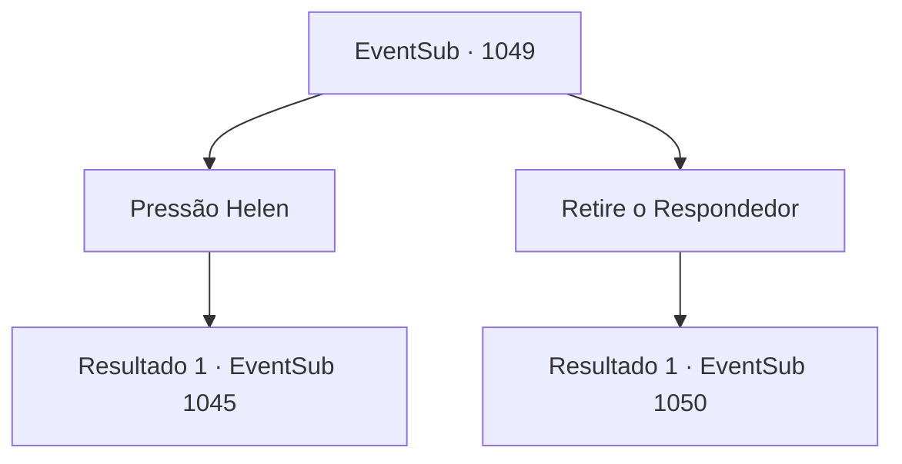

# Eventos secundários · 1049

[Índice da tabela](index.md) · [Índice geral](../index.md)

ID: `pt:EventSub:1049` · Fonte: `EventSub4` · Versão: 1.2.47.

Mapeamento estático dos arquivos; a disponibilidade e a execução dependem do estado da run.

## Texto do evento

*Sem texto no arquivo.*

## Dados de entrada

```json
{
  "id": 1049,
  "grade": 1,
  "subEvent": "",
  "required": ""
}
```

## Mapa das escolhas



## Escolhas e resultados

### Escolha 1

Pressão Helen

Requisitos e outros campos da escolha:

```json
{
  "required": ""
}
```

#### Resultado 1.1

Você encurrala Helen, exigindo que ela diga a verdade. A empregada mais velha lhe diz para parar, protegendo Helen. 

 "Ora, não é como se você tivesse provas materiais. Somos apenas trabalhadores contratados que servem nosso senhor. Por favor, não podemos permitir mais interrupções."

 Ela soa determinada - você não conseguirá arrancar informações delas agora. Infelizmente, você sai dos aposentos das empregadas para verificar outros lugares.

Continuação registrada: [Evento 1045](1045.md) na mesma tabela.

```json
{
  "required": "",
  "chance": "1",
  "nextEvent": 1045,
  "type": 2,
  "reward": ""
}
```

### Escolha 2

Retire o Respondedor

Requisitos e outros campos da escolha:

```json
{
  "required": "8_93_1"
}
```

#### Resultado 2.1

Você tira o Respondedor. Por conta própria, ele flutua em direção ao pescoço de Helen. Assustada, Helen começa a contar tudo. 

 "O- o pó é veneno! Ele disse que é Cascata do Diabo moída!"

 O rosto de Helen está pálido. Ela acrescenta, como se estivesse pensando em uma desculpa. 

 "E- eu não tive escolha! O médico tinha ligações próximas com a Sra. Hazel, e eu simplesmente não podia dizer não...!"

 Sua voz começa a tremer. Seus olhos estão tremendo de medo. 

 "Além disso... eu não fui a única que fez isso!"

 Por fim, Helen cai no chão e começa a chorar.

Continuação registrada: [Evento 1050](1050.md) na mesma tabela.

```json
{
  "required": "",
  "chance": "1",
  "nextEvent": 1050,
  "type": 2,
  "reward": ""
}
```

## Referências que chegam a este evento

- [Evento 1048 · escolha 2 · resultado 3](1048.md#escolha-2)
