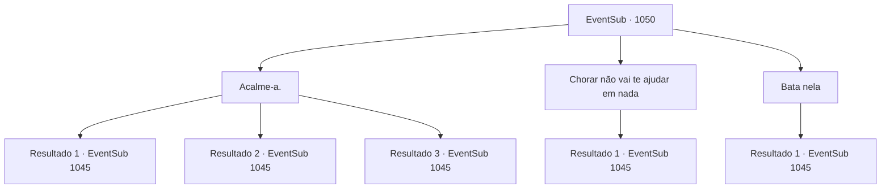

# Eventos secundários · 1050

[Índice da tabela](index.md) · [Índice geral](../index.md)

ID: `pt:EventSub:1050` · Fonte: `EventSub4` · Versão: 1.2.47.

Mapeamento estático dos arquivos; a disponibilidade e a execução dependem do estado da run.

## Texto do evento

*Sem texto no arquivo.*

## Dados de entrada

```json
{
  "id": 1050,
  "grade": 1,
  "subEvent": "",
  "required": ""
}
```

## Mapa das escolhas



## Escolhas e resultados

### Escolha 1

Acalme-a.

Requisitos e outros campos da escolha:

```json
{
  "required": "1_1_2"
}
```

#### Resultado 1.1

Você fala com Helen com paciência, pedindo para ela explicar por que o médico da corte simplesmente lhe entregaria o veneno. 

 "Paldianos é... tipo, ele foi contratado recentemente. A Sra. Hazel o recomendou, na verdade... Ele me disse para colocar o pó nas refeições do Jovem Mestre Edward, aos poucos..."

 A empregada doméstica soluça, enxugando as lágrimas dos olhos. 

 "Ele disse que, se eu não fizesse isso... coisas ruins aconteceriam comigo e com minha família! Então... eu não tive escolha a não ser ouvi-lo... P- por favor, não me mate..."

 Helen então procede a recitar uma lista completa das empregadas. É revelado que outras três empregadas também envenenaram as refeições de Edward. A empregada mais velha ouve a confissão de Helen e responde. 

 "As três devem estar dormindo agora. Vou notificar o Conde e mandá-las prender. Nós mesmos não teríamos notado nada de errado com Helen. Obrigado."


Continuação registrada: [Evento 1045](1045.md) na mesma tabela.

```json
{
  "required": "",
  "chance": "1|0_14_1",
  "nextEvent": 1045,
  "type": 0,
  "reward": "0_3_3|5_816_1"
}
```

#### Resultado 1.2

Você tenta acalmar Helen com paciência. Você realmente tentou. Mas depois de ouvi-la inventar desculpas repetidamente, você conclui que já teve o suficiente. Por um breve momento, você perde o controle do seu corpo, dando um tapa na bochecha da empregada. A velha empregada te interrompe. 

 "Deixe-me falar com ela."

 Você espera do lado de fora da porta, se acalmando. Logo, a velha empregada sai do quarto e fala com você. 

 "Aparentemente, Helen e outras três empregadas foram ameaçadas pelo médico da corte, 'Paldianos'. Elas não tiveram escolha a não ser colocar um pouco de veneno, aos poucos, nas refeições do Jovem Mestre."

 Ela solta um suspiro triste e continua. 

 "As três devem estar dormindo agora. Vou avisar o Conde e mandá-las prender. Nós mesmos não teríamos notado nada de errado com Helen. Obrigada."


Continuação registrada: [Evento 1045](1045.md) na mesma tabela.

```json
{
  "required": "2_3_0",
  "chance": "10",
  "nextEvent": 1045,
  "type": 1,
  "reward": "0_1_-1|0_3_-1|5_816_1"
}
```

#### Resultado 1.3

Você tenta acalmar Helen com paciência. Você realmente tentou. Mas depois de ouvi-la inventar desculpas repetidamente, você conclui que já teve o suficiente. Sem nem perceber, você cerra os punhos. A velha empregada te impede. 

 "Deixe-me falar com ela."

 Você espera do lado de fora da porta, se acalmando. Logo, a velha empregada sai do quarto e fala com você. 

 "Aparentemente, Helen e outras três empregadas foram ameaçadas pelo médico da corte, 'Paldianos'. Elas não tiveram escolha a não ser colocar um pouco de veneno, aos poucos, nas refeições do Jovem Mestre."

 Ela solta um suspiro triste e continua. 

 "As três devem estar dormindo agora. Vou avisar o Conde e mandá-las prender. Nós mesmos não teríamos notado nada de errado com Helen. Obrigada."


Continuação registrada: [Evento 1045](1045.md) na mesma tabela.

```json
{
  "required": "1_3_0",
  "chance": "10",
  "nextEvent": 1045,
  "type": 1,
  "reward": "0_1_-1|5_816_1"
}
```

### Escolha 2

Chorar não vai te ajudar em nada

Requisitos e outros campos da escolha:

```json
{
  "required": ""
}
```

#### Resultado 2.1

Você pressiona Helen a falar, agarrando-a pela gola e sacudindo-a. A velha empregada te interrompe. 

 "Por que você não espera lá fora. Deixe-me falar com ela."

 Você espera do lado de fora da porta, se acalmando. Logo, a velha empregada sai do quarto e fala com você. 

 "Aparentemente, Helen e outras três empregadas foram ameaçadas pelo médico da corte, 'Paldianos'. Elas não tiveram escolha a não ser colocar um pouco de veneno, aos poucos, nas refeições do Jovem Mestre."

 Ela solta um suspiro triste e continua. 

 "As três devem estar dormindo agora. Vou notificar o Conde e mandá-las prender. Nós mesmos não teríamos notado nada de errado com Helen. Obrigada."


Continuação registrada: [Evento 1045](1045.md) na mesma tabela.

```json
{
  "required": "",
  "chance": "1",
  "nextEvent": 1045,
  "type": 2,
  "reward": "5_816_1"
}
```

### Escolha 3

Bata nela

Requisitos e outros campos da escolha:

```json
{
  "required": "2_3_-14"
}
```

#### Resultado 3.1

Você dá um bom tapa nas bochechas da empregada. Helen treme por alguns segundos antes de cair no chão. A velha empregada te para. 

 "Deixe-me falar com ela."

 Você espera do lado de fora da porta, se acalmando. Logo, a velha empregada sai do quarto e fala com você. 

 "Aparentemente, Helen e outras três empregadas foram ameaçadas pelo médico da corte, 'Paldianos'. Elas não tiveram escolha a não ser colocar um pouco de veneno, aos poucos, nas refeições do Jovem Mestre."

 Ela solta um suspiro triste e continua. 

 "As três devem estar dormindo agora. Vou avisar o Conde e mandá-las prender. Nós mesmos não teríamos notado nada de errado com a Helen. Obrigada."


Continuação registrada: [Evento 1045](1045.md) na mesma tabela.

```json
{
  "required": "",
  "chance": "1",
  "nextEvent": 1045,
  "type": 2,
  "reward": "0_1_1|5_816_1"
}
```

## Referências que chegam a este evento

- [Evento 1048 · escolha 1 · resultado 2](1048.md#escolha-1)
- [Evento 1048 · escolha 2 · resultado 1](1048.md#escolha-2)
- [Evento 1048 · escolha 2 · resultado 2](1048.md#escolha-2)
- [Evento 1048 · escolha 3 · resultado 1](1048.md#escolha-3)
- [Evento 1048 · escolha 3 · resultado 2](1048.md#escolha-3)
- [Evento 1048 · escolha 3 · resultado 3](1048.md#escolha-3)
- [Evento 1049 · escolha 2 · resultado 1](1049.md#escolha-2)
