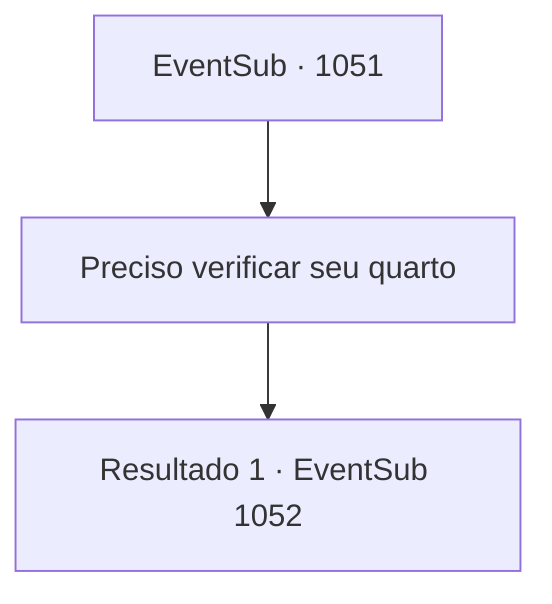

# Eventos secundários · 1051

[Índice da tabela](index.md) · [Índice geral](../index.md)

ID: `pt:EventSub:1051` · Fonte: `EventSub4` · Versão: 1.2.47.

Mapeamento estático dos arquivos; a disponibilidade e a execução dependem do estado da run.

## Texto do evento

*Sem texto no arquivo.*

## Dados de entrada

```json
{
  "id": 1051,
  "grade": 1,
  "subEvent": "",
  "required": ""
}
```

## Mapa das escolhas



## Escolhas e resultados

### Escolha 1

Preciso verificar seu quarto

Requisitos e outros campos da escolha:

```json
{
  "required": ""
}
```

#### Resultado 1.1

Você diz ao médico que precisa verificar o quarto dele. Mas ele se opõe a isso. 

 "Meus medicamentos são voláteis e frágeis. Até o próprio Conde não os toca sozinho. Quem é você para invadir meu quarto e mexer neles?"


Continuação registrada: [Evento 1052](1052.md) na mesma tabela.

```json
{
  "required": "",
  "chance": "1",
  "nextEvent": 1052,
  "type": 2,
  "reward": ""
}
```

## Referências que chegam a este evento

- [Evento 1045 · escolha 3 · resultado 1](1045.md#escolha-3)
