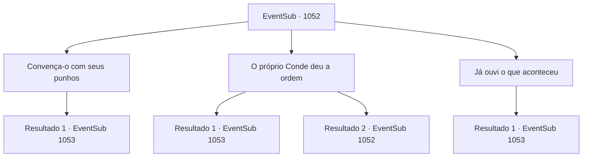

# Eventos secundários · 1052

[Índice da tabela](index.md) · [Índice geral](../index.md)

ID: `pt:EventSub:1052` · Fonte: `EventSub4` · Versão: 1.2.47.

Mapeamento estático dos arquivos; a disponibilidade e a execução dependem do estado da run.

## Texto do evento

*Sem texto no arquivo.*

## Dados de entrada

```json
{
  "id": 1052,
  "grade": 1,
  "subEvent": "",
  "required": ""
}
```

## Mapa das escolhas



## Escolhas e resultados

### Escolha 1

Convença-o com seus punhos

Requisitos e outros campos da escolha:

```json
{
  "required": ""
}
```

#### Resultado 1.1

Você espancou o médico da corte. Ele não é treinado em combate - incapaz de suportar a surra, logo desaba no chão. Com o médico subjugado, você vasculha as coisas dele em seu quarto. Então, você encontra uma carta escondida, enfiada debaixo da mesa dele. Escrita na carta está um pedido de Hazel Ronan.   'Confio a você enfraquecer a saúde de Edward gradualmente. Tome cuidado extra para não chamar muita atenção.' O médico vê você lendo a carta, fica pálido e então fala. 

 "...Você poderia me acompanhar por um momento? Acredito que esta conversa é melhor realizada em um lugar mais discreto."

 Ele o leva a uma sala localizada nas partes internas do castelo. Lá, você encontra Hazel, a segunda esposa do Conde. Hazel vê você e o médico, então ordena que as empregadas se retirem. 

 "É um prazer, {1}. Eu... agradeço por salvar a vida de Edward."

 Você percebe pelo jeito que ela fala que ela não está nem um pouco grata. O médico da corte se aproxima de Hazel e sussurra algo em seu ouvido. Hazel suspira e continua. 

 "*suspiro*... Vou direto ao ponto. Preciso da sua ajuda."


Continuação registrada: [Evento 1053](1053.md) na mesma tabela.

```json
{
  "required": "",
  "chance": "1",
  "nextEvent": 1053,
  "type": 2,
  "reward": ""
}
```

### Escolha 2

O próprio Conde deu a ordem

Requisitos e outros campos da escolha:

```json
{
  "required": "5_848_0"
}
```

#### Resultado 2.1

Você conta uma mentira convincente, usando a autoridade do Conde como desculpa. O médico parece confuso. 

 "H- hein? Isso não pode ser..."

 Enquanto ele tenta entender, você o empurra de lado e revira o quarto dele. Então, você encontra uma carta escondida, enfiada debaixo da mesa. Escrito na carta está um pedido de Hazel Ronan. 
 'Confio a você enfraquecer gradualmente a saúde de Edward. Tome cuidado extra para não chamar muita atenção.' O médico vê você lendo a carta, fica pálido e então fala. 

 "...Você poderia me acompanhar por um momento? Acredito que essa conversa é melhor realizada em um lugar mais discreto."

 Ele o leva a um quarto localizado nas partes internas do castelo. Lá, você encontra Hazel, a segunda esposa do Conde. Hazel vê você e o médico, então ordena que as criadas saiam. 

 "É um prazer, {1}. Eu... agradeço por salvar a vida de Edward."

 Você percebe pelo jeito que ela fala que ela não está nem um pouco grata. O médico da corte se aproxima de Hazel e sussurra algo em seu ouvido. Hazel suspira e continua. 

 "*suspiro*... Vou direto ao ponto. Preciso da sua ajuda."


Continuação registrada: [Evento 1053](1053.md) na mesma tabela.

```json
{
  "required": "",
  "chance": "1|0_12_1",
  "nextEvent": 1053,
  "type": 0,
  "reward": "5_848_1"
}
```

#### Resultado 2.2

Você tenta usar a autoridade do Conde como desculpa, mas o médico não se deixa enganar. 

 "Hum. Você precisa aprender a contar mentiras melhores."

 Nada convencido, o médico grita para você sair.

Continuação registrada: [Evento 1052](1052.md) na mesma tabela.

```json
{
  "required": "",
  "chance": "10",
  "nextEvent": 1052,
  "type": 1,
  "reward": "5_848_2"
}
```

### Escolha 3

Já ouvi o que aconteceu

Requisitos e outros campos da escolha:

```json
{
  "required": "5_816_1"
}
```

#### Resultado 3.1

Você diz a ele que já ouviu a história das empregadas. O médico da corte fica em silêncio, olha para você por alguns segundos, depois se levanta. 

 "...Entendo. Poderia me acompanhar por um momento? Acredito que esta conversa é melhor realizada em um lugar mais discreto."

 Ele o leva a uma sala localizada nas partes internas do castelo. Lá, você encontra Hazel, a segunda esposa do Conde. Hazel vê você e o médico, então ordena que as empregadas saiam. 

 "É um prazer, {1}. Eu... agradeço por salvar a vida de Edward."

 Você percebe pelo jeito que ela fala que não está nem um pouco grata. O médico da corte se aproxima de Hazel e sussurra algo em seu ouvido. Hazel suspira e continua. 

 "*suspiro*... Vou direto ao ponto. Preciso da sua ajuda."


Continuação registrada: [Evento 1053](1053.md) na mesma tabela.

```json
{
  "required": "",
  "chance": "1",
  "nextEvent": 1053,
  "type": 2,
  "reward": ""
}
```

## Referências que chegam a este evento

- [Evento 1051 · escolha 1 · resultado 1](1051.md#escolha-1)
- [Evento 1052 · escolha 2 · resultado 2](1052.md#escolha-2)
