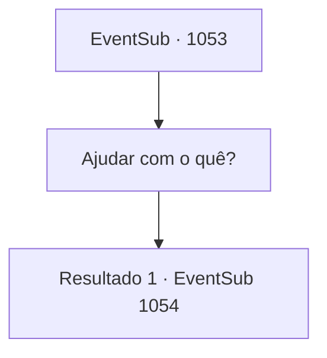

# Eventos secundários · 1053

[Índice da tabela](index.md) · [Índice geral](../index.md)

ID: `pt:EventSub:1053` · Fonte: `EventSub4` · Versão: 1.2.47.

Mapeamento estático dos arquivos; a disponibilidade e a execução dependem do estado da run.

## Texto do evento

*Sem texto no arquivo.*

## Dados de entrada

```json
{
  "id": 1053,
  "grade": 1,
  "subEvent": "",
  "required": ""
}
```

## Mapa das escolhas



## Escolhas e resultados

### Escolha 1

Ajudar com o quê?

Requisitos e outros campos da escolha:

```json
{
  "required": ""
}
```

#### Resultado 1.1

Hazel continua, esfregando a barriga. 

 "Estou grávida de uma criança. Quero que meu bebê herde o condado. E para isso... preciso que Edward saia do caminho."

 Ela olha nos seus olhos e implora desesperadamente. 

 "Além disso, um menino amaldiçoado com albinismo se tornando líder de um condado? Isso não faz sentido!"

 Ela para brevemente, como se esperasse seu acordo. Não vendo nenhum, ela continua. 

 "Então, o que eu quero de você é... apenas ficar quieto. Só por alguns dias. Ah, não estou pedindo para você fazer isso de graça, claro. Farei a compensação necessária, é claro."

 Hazel sorri misteriosamente, aguardando sua resposta.

Continuação registrada: [Evento 1054](1054.md) na mesma tabela.

```json
{
  "required": "",
  "chance": "1",
  "nextEvent": 1054,
  "type": 2,
  "reward": "5_818_1"
}
```

## Referências que chegam a este evento

- [Evento 1052 · escolha 1 · resultado 1](1052.md#escolha-1)
- [Evento 1052 · escolha 2 · resultado 1](1052.md#escolha-2)
- [Evento 1052 · escolha 3 · resultado 1](1052.md#escolha-3)
