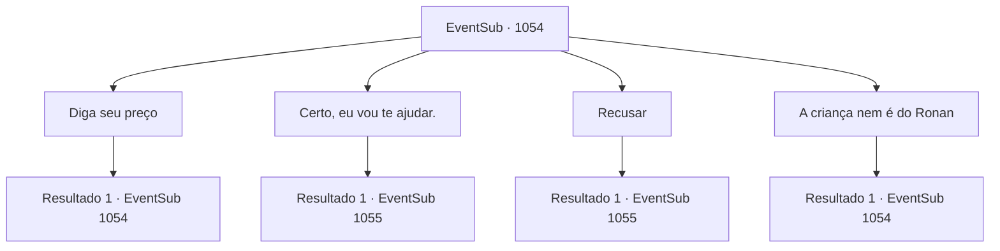

# Eventos secundários · 1054

[Índice da tabela](index.md) · [Índice geral](../index.md)

ID: `pt:EventSub:1054` · Fonte: `EventSub4` · Versão: 1.2.47.

Mapeamento estático dos arquivos; a disponibilidade e a execução dependem do estado da run.

## Texto do evento

*Sem texto no arquivo.*

## Dados de entrada

```json
{
  "id": 1054,
  "grade": 1,
  "subEvent": "",
  "required": ""
}
```

## Mapa das escolhas



## Escolhas e resultados

### Escolha 1

Diga seu preço

Requisitos e outros campos da escolha:

```json
{
  "required": "5_819_0"
}
```

#### Resultado 1.1

O sorriso de Hazel se intensifica. Ela promete a você o cargo de Marechal do Tribunal do Condado de Ronan, caso tudo corra bem. 

 "Lembraremos de contatá-lo se tudo der certo. Você poderá reivindicar seu prêmio então."


Continuação registrada: [Evento 1054](1054.md) na mesma tabela.

```json
{
  "required": "",
  "chance": "1",
  "nextEvent": 1054,
  "type": 2,
  "reward": "5_819_1"
}
```

### Escolha 2

Certo, eu vou te ajudar.

Requisitos e outros campos da escolha:

```json
{
  "required": "5_820_0"
}
```

#### Resultado 2.1

Você aceita a oferta de Hazel. Ela sorri feliz, então estende as mãos para segurar as suas. 

 "Obrigada por nos ajudar. Eu falo sério."

 Você sai do quarto dela e retorna ao aposento de hóspedes. Lá, você se encontra com Irema. Elegantemente tomando chá na mesa, ela se vira e percebe você. 

 "Você voltou. Temos uma pista?"


Continuação registrada: [Evento 1055](1055.md) na mesma tabela.

```json
{
  "required": "",
  "chance": "1",
  "nextEvent": 1055,
  "type": 2,
  "reward": "5_820_1"
}
```

### Escolha 3

Recusar

Requisitos e outros campos da escolha:

```json
{
  "required": ""
}
```

#### Resultado 3.1

Você recusa a oferta de Hazel. Você sai do quarto dela e volta para o aposento de hóspedes. Lá, você se encontra com Irema. Graciosamente tomando chá na mesa, ela se vira e percebe você. 

 "Você voltou. Temos uma pista?"


Continuação registrada: [Evento 1055](1055.md) na mesma tabela.

```json
{
  "required": "",
  "chance": "1",
  "nextEvent": 1055,
  "type": 2,
  "reward": ""
}
```

### Escolha 4

A criança nem é do Ronan

Requisitos e outros campos da escolha:

```json
{
  "required": "5_786_1|5_821_0"
}
```

#### Resultado 4.1

Você desafia a afirmação dela logicamente. Hazel te encara por um breve momento, antes de soltar um longo suspiro. 

 "Então você realmente sabe de tudo. Bem, minha oferta ainda está de pé. Ajude-nos, e eu posso te prometer uma recompensa suficiente. Se quiser, também há a opção de me prender. Então, eu e meu bebê vamos... direto para a forca, eu acho."

 Os olhos de Hazel começam a ficar vermelhos enquanto ela começa a chorar.

Continuação registrada: [Evento 1054](1054.md) na mesma tabela.

```json
{
  "required": "",
  "chance": "1",
  "nextEvent": 1054,
  "type": 2,
  "reward": "5_821_1"
}
```

## Referências que chegam a este evento

- [Evento 1053 · escolha 1 · resultado 1](1053.md#escolha-1)
- [Evento 1054 · escolha 1 · resultado 1](1054.md#escolha-1)
- [Evento 1054 · escolha 4 · resultado 1](1054.md#escolha-4)
