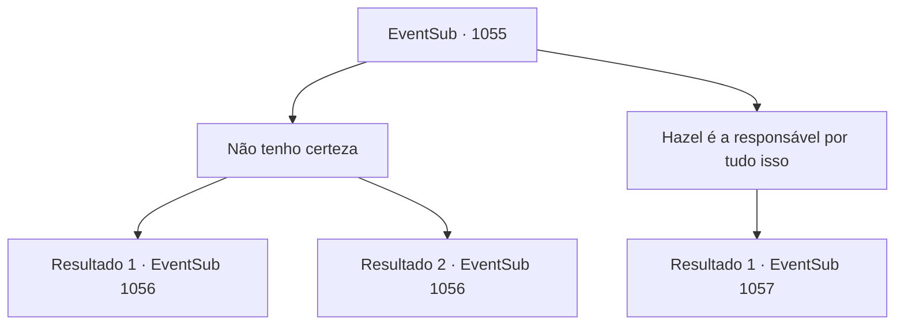

# Eventos secundários · 1055

[Índice da tabela](index.md) · [Índice geral](../index.md)

ID: `pt:EventSub:1055` · Fonte: `EventSub4` · Versão: 1.2.47.

Mapeamento estático dos arquivos; a disponibilidade e a execução dependem do estado da run.

## Texto do evento

*Sem texto no arquivo.*

## Dados de entrada

```json
{
  "id": 1055,
  "grade": 1,
  "subEvent": "",
  "required": ""
}
```

## Mapa das escolhas



## Escolhas e resultados

### Escolha 1

Não tenho certeza

Requisitos e outros campos da escolha:

```json
{
  "required": ""
}
```

#### Resultado 1.1

Irema faz o melhor para esconder a decepção. 

 "Entendo... Obrigada pela sua ajuda. A refeição estará pronta em breve. Agora, se me der licença."

 Ela sai do quarto de hóspedes. Logo, uma empregada entra e anuncia que a comida está pronta. Você se serve da refeição do Conde. Ronan sorri calorosamente e fala. 

 "Agradeço novamente, {1}. Minha Casa não é exatamente conhecida por suas riquezas, mas temos raízes que remontam a uma linhagem de um grande guerreiro. História de orgulho, eu diria."

 Ele continua, mostrando a você a relíquia da família. 

 "Aqui - uma lança ancestral, passada por gerações. Ah, e se você não quiser a lança, ficarei feliz em pagar-lhe com ouro, do meu acervo pessoal."


Continuação registrada: [Evento 1056](1056.md) na mesma tabela.

```json
{
  "required": "18_792_1",
  "chance": "1",
  "nextEvent": 1056,
  "type": 2,
  "reward": ""
}
```

#### Resultado 1.2

Irema faz o melhor para esconder a decepção. 

 "Entendo... Obrigada pela sua ajuda. A refeição estará pronta em breve. Agora, se me der licença."

 Ela sai do quarto de hóspedes. Logo, Erina entra para lhe dizer que a comida está pronta. 

 "Venha, venha! Vamos!"

 Erina pega sua mão e o leva para a sala de jantar. Você se serve da refeição do Conde. Ronan sorri calorosamente e fala. 

 "Agradeço novamente, {1}. Minha Casa não é exatamente conhecida por suas riquezas, mas temos raízes que remontam a uma linhagem de um grande guerreiro. História de orgulho, eu diria."

 Ele continua, mostrando-lhe a relíquia da família. 

 "Aqui - uma lança ancestral, passada por gerações. Ah, e se você não quiser a lança, ficarei feliz em pagá-lo com ouro, do meu acervo pessoal."


Continuação registrada: [Evento 1056](1056.md) na mesma tabela.

```json
{
  "required": "5_792_1",
  "chance": "1",
  "nextEvent": 1056,
  "type": 2,
  "reward": ""
}
```

### Escolha 2

Hazel é a responsável por tudo isso

Requisitos e outros campos da escolha:

```json
{
  "required": "5_818_1"
}
```

#### Resultado 2.1

Você mostra a ela evidências materiais do médico da corte cumprindo as ordens de Hazel de prejudicar deliberadamente Edward. Irema lê a carta, tremendo. 

 "H- HAZEL, AQUELA BRUXA...! Eu tinha minhas suspeitas, mas isso... Obrigada pelo trabalho árduo. Agora, com licença."

 Ela agarra a borda do vestido e sai correndo da sala. Logo, você ouve uma comoção. Você segue o barulho até o salão principal. |drawing_ladiesFight| Lá, você se depara com um duelo das duas esposas. 

 "HAZEL! COMO OUSA! COMO OUSA...!!"

 "ARGH! SOLTE! VOCÊ ESTÁ LOUCA?!"

 O Conde está ao lado delas, sem saber o que fazer.

Continuação registrada: [Evento 1057](1057.md) na mesma tabela.

```json
{
  "required": "",
  "chance": "1",
  "nextEvent": 1057,
  "type": 2,
  "reward": ""
}
```

## Referências que chegam a este evento

- [Evento 1045 · escolha 4 · resultado 1](1045.md#escolha-4)
- [Evento 1054 · escolha 2 · resultado 1](1054.md#escolha-2)
- [Evento 1054 · escolha 3 · resultado 1](1054.md#escolha-3)
