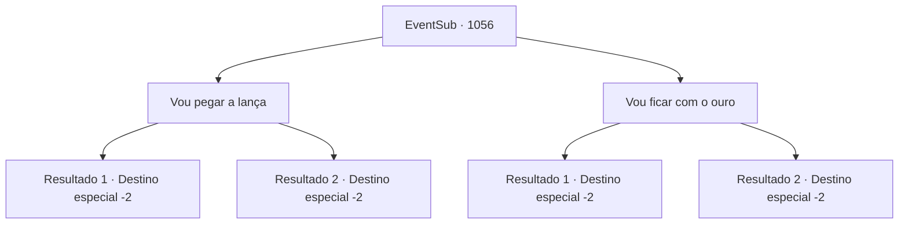

# Eventos secundários · 1056

[Índice da tabela](index.md) · [Índice geral](../index.md)

ID: `pt:EventSub:1056` · Fonte: `EventSub4` · Versão: 1.2.47.

Mapeamento estático dos arquivos; a disponibilidade e a execução dependem do estado da run.

## Texto do evento

*Sem texto no arquivo.*

## Dados de entrada

```json
{
  "id": 1056,
  "grade": 1,
  "subEvent": "",
  "required": ""
}
```

## Mapa das escolhas



## Escolhas e resultados

### Escolha 1

Vou pegar a lança

Requisitos e outros campos da escolha:

```json
{
  "required": ""
}
```

#### Resultado 1.1

Você diz a ele que ficará com a lança ancestral. Ronan sorri feliz, entregando-lhe a arma de herança. 

 "Faça bom uso dela. E obrigado novamente por salvar Edward."

 Ele pessoalmente o acompanha para fora do castelo.

Continuação registrada: [Destino especial `-2`](../destinos-especiais.md).

```json
{
  "required": "18_792_1",
  "chance": "1",
  "nextEvent": -2,
  "type": 2,
  "reward": "3_367_1|12_12_-1|14_12_10"
}
```

#### Resultado 1.2

Você diz a ele que ficará com a lança ancestral. Ronan sorri feliz, entregando-lhe a arma de herança. 

 "Faça bom uso dela. E obrigado novamente por salvar Edward."

 Ele pessoalmente o acompanha para fora do castelo.

Continuação registrada: [Destino especial `-2`](../destinos-especiais.md).

```json
{
  "required": "5_792_1",
  "chance": "1",
  "nextEvent": -2,
  "type": 2,
  "reward": "3_367_1|12_12_-1|14_12_10"
}
```

### Escolha 2

Vou ficar com o ouro

Requisitos e outros campos da escolha:

```json
{
  "required": ""
}
```

#### Resultado 2.1

Você diz a ele que ficará com o ouro. Ronan sorri feliz, entregando-lhe um baú cheio de ouro. 

 "Faça bom uso disso. E obrigado novamente por salvar Edward."

 Ele pessoalmente o acompanha para fora do castelo.

Continuação registrada: [Destino especial `-2`](../destinos-especiais.md).

```json
{
  "required": "18_792_1",
  "chance": "1",
  "nextEvent": -2,
  "type": 2,
  "reward": "0_4_200|12_12_-1|14_12_10"
}
```

#### Resultado 2.2

Você diz a ele que ficará com o ouro. Ronan sorri feliz, entregando-lhe um baú cheio de ouro. 

 "Faça bom uso disso. E obrigado novamente por salvar Edward."

 Ele pessoalmente o acompanha para fora do castelo.

Continuação registrada: [Destino especial `-2`](../destinos-especiais.md).

```json
{
  "required": "5_792_1",
  "chance": "1",
  "nextEvent": -2,
  "type": 2,
  "reward": "0_4_200|12_12_-1|14_12_10"
}
```

## Referências que chegam a este evento

- [Evento 1055 · escolha 1 · resultado 1](1055.md#escolha-1)
- [Evento 1055 · escolha 1 · resultado 2](1055.md#escolha-1)
