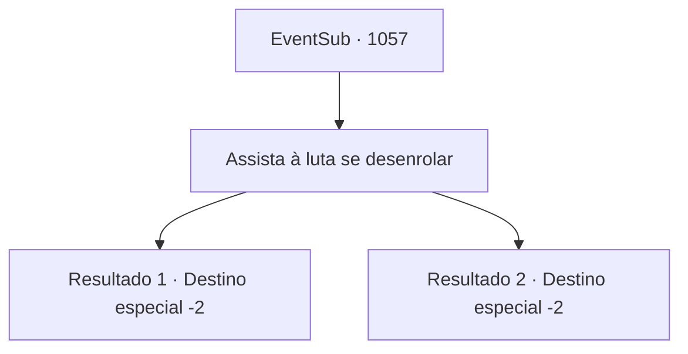

# Eventos secundários · 1057

[Índice da tabela](index.md) · [Índice geral](../index.md)

ID: `pt:EventSub:1057` · Fonte: `EventSub4` · Versão: 1.2.47.

Mapeamento estático dos arquivos; a disponibilidade e a execução dependem do estado da run.

## Texto do evento

*Sem texto no arquivo.*

## Dados de entrada

```json
{
  "id": 1057,
  "grade": 1,
  "subEvent": "",
  "required": ""
}
```

## Mapa das escolhas



## Escolhas e resultados

### Escolha 1

Assista à luta se desenrolar

Requisitos e outros campos da escolha:

```json
{
  "required": ""
}
```

#### Resultado 1.1

Você assiste à graciosa luta entre as duas nobres mulheres se desenrolar. Puxando cabelos e rasgando os vestidos caros - é uma cena e tanto. Só depois que o próprio Conde, as empregadas e o mordomo vêm para pará-las é que a luta cessa. 

 "I- Irema! O que deu em você?!"

 O Conde parece surpreso ao ver a Condessa nesse estado. Irema responde, gritando. 

 "Hazel tem tentado matar Edward o tempo todo! Se não fosse pela ajuda de {1}, teríamos perdido nosso menino!"

 Sua voz se quebra de raiva. A princípio, Hazel nega todas as acusações. Mas com seu testemunho e a descoberta das cartas de Hazel, ela é considerada culpada e é enviada para as masmorras do castelo. Depois que as coisas se acalmam, o Conde solta um longo suspiro e fala. 

 "...Você não precisava ter visto isso."

 Ele enxuga o suor do rosto e continua. 

 "Certo, continuando... Não posso acreditar, mas você salvou meu filho novamente. Obrigado mais uma vez. Minha Casa não é exatamente conhecida por suas riquezas, mas temos raízes que remontam a uma linhagem de um grande guerreiro. História de orgulho, eu diria."

 Ele continua, mostrando a você a relíquia da família. 

 "Aqui - uma lança ancestral, passada por gerações. Ah, e um pouco de ouro, do meu acervo pessoal. Obrigado novamente, aventureiro."

 Ele inclina a cabeça para mostrar sua gratidão.

Continuação registrada: [Destino especial `-2`](../destinos-especiais.md).

```json
{
  "required": "18_792_1",
  "chance": "1",
  "nextEvent": -2,
  "type": 2,
  "reward": "3_367_1|0_4_200|12_12_8|14_12_1"
}
```

#### Resultado 1.2

Você assiste à graciosa luta entre as duas nobres mulheres se desenrolar. Puxando cabelos e rasgando os vestidos caros - é uma cena e tanto. Só depois que o próprio Conde, as empregadas e o mordomo vêm para pará-las é que a luta cessa. 

 "I- Irema! O que deu em você?!"

 O Conde parece surpreso ao ver a Condessa nesse estado. Irema responde, gritando. 

 "Hazel tem tentado matar Edward o tempo todo! Se não fosse pela ajuda de {1}, teríamos perdido nosso menino!"

 Sua voz se quebra de raiva. A princípio, Hazel nega todas as acusações. Mas com seu testemunho e a descoberta das cartas de Hazel, ela é considerada culpada e é enviada para as masmorras do castelo. Depois que as coisas se acalmam, o Conde solta um longo suspiro e fala. 

 "...Você não precisava ter visto isso."

 Ele enxuga o suor do rosto e continua. 

 "Certo, continuando... Não posso acreditar, mas você salvou meu filho novamente. Obrigado mais uma vez. Minha Casa não é exatamente conhecida por suas riquezas, mas temos raízes que remontam a uma linhagem de um grande guerreiro. História de orgulho, eu diria."

 Ele continua, mostrando a você a relíquia da família. 

 "Aqui - uma lança ancestral, passada por gerações. Ah, e um pouco de ouro, do meu acervo pessoal. Obrigado novamente, aventureiro."

 Ele inclina a cabeça para mostrar sua gratidão.

Continuação registrada: [Destino especial `-2`](../destinos-especiais.md).

```json
{
  "required": "5_792_1",
  "chance": "1",
  "nextEvent": -2,
  "type": 2,
  "reward": "3_367_1|0_4_200|12_12_8|14_12_1|14_12_8"
}
```

## Referências que chegam a este evento

- [Evento 1055 · escolha 2 · resultado 1](1055.md#escolha-2)
