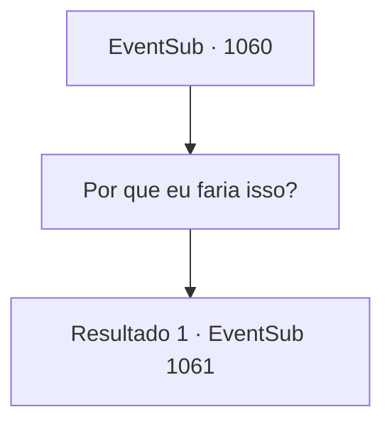

# Eventos secundários · 1060

[Índice da tabela](index.md) · [Índice geral](../index.md)

ID: `pt:EventSub:1060` · Fonte: `EventSub4` · Versão: 1.2.47.

Mapeamento estático dos arquivos; a disponibilidade e a execução dependem do estado da run.

## Texto do evento

*Sem texto no arquivo.*

## Dados de entrada

```json
{
  "id": 1060,
  "grade": 1,
  "subEvent": "",
  "required": ""
}
```

## Mapa das escolhas



## Escolhas e resultados

### Escolha 1

Por que eu faria isso?

Requisitos e outros campos da escolha:

```json
{
  "required": ""
}
```

#### Resultado 1.1

Milorad responde com um desdém. 

 "Eu tenho ouvidos, sabe. Você não estava indo atrás dele sozinho?"

 Ele sorri misteriosamente e acrescenta. 

 "Deixe-me ajudá-lo. Vou te contar onde Lukas está se escondendo. Isso beneficiaria a ambos, já que estamos atrás da mesma coisa."


Continuação registrada: [Evento 1061](1061.md) na mesma tabela.

```json
{
  "required": "",
  "chance": "1",
  "nextEvent": 1061,
  "type": 2,
  "reward": ""
}
```

## Referências que chegam a este evento

- [Evento 1059 · escolha 1 · resultado 1](1059.md#escolha-1)
- [Evento 1059 · escolha 2 · resultado 1](1059.md#escolha-2)
