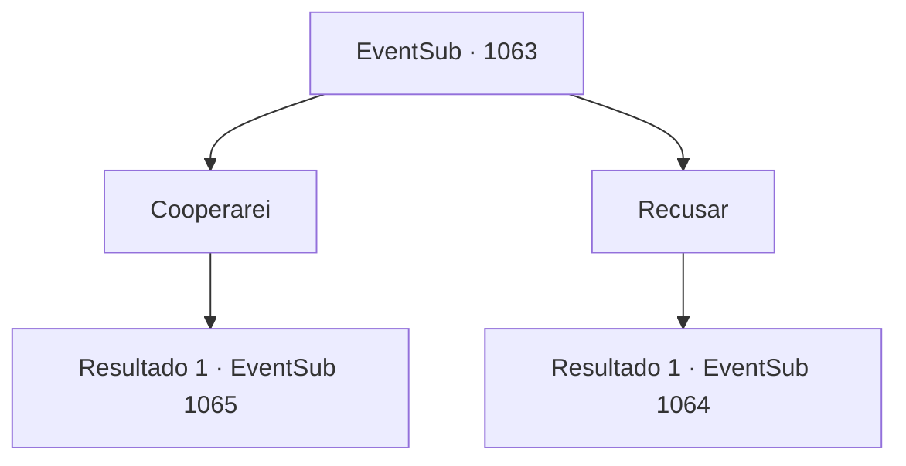

# Eventos secundários · 1063

[Índice da tabela](index.md) · [Índice geral](../index.md)

ID: `pt:EventSub:1063` · Fonte: `EventSub4` · Versão: 1.2.47.

Mapeamento estático dos arquivos; a disponibilidade e a execução dependem do estado da run.

## Texto do evento

*Sem texto no arquivo.*

## Dados de entrada

```json
{
  "id": 1063,
  "grade": 1,
  "subEvent": "",
  "required": ""
}
```

## Mapa das escolhas



## Escolhas e resultados

### Escolha 1

Cooperarei

Requisitos e outros campos da escolha:

```json
{
  "required": ""
}
```

#### Resultado 1.1

Você concorda em ajudar Milorad. Ele sorri silenciosamente, então estende a mão para um aperto de mão. 

 "Ele está se escondendo nas Catacumbas na diocese. Siga-me. Eu vou te levar até lá."

 Você segue Milorad até as Catacumbas, onde dizem que Lukas está se escondendo. |drawing_catacomb| Uma enorme colina impede que os raios do sol alcancem este lugar. A área parece sinistra e sombria, e ainda nem era noite. 

 "Espere. Eu tenho uma ideia."

 Milorad sugere amarrar suas mãos para trás. Ele acrescenta que você teria uma chance melhor de pegar Lukas de surpresa assim.

Continuação registrada: [Evento 1065](1065.md) na mesma tabela.

```json
{
  "required": "",
  "chance": "1",
  "nextEvent": 1065,
  "type": 2,
  "reward": ""
}
```

### Escolha 2

Recusar

Requisitos e outros campos da escolha:

```json
{
  "required": ""
}
```

#### Resultado 2.1

Você se recusa a ajudar Milorad. Ele se afasta da fogueira e murmura. 

 "As catacumbas da diocese. É lá que ele está se escondendo."

 Ele então vai embora.

Continuação registrada: [Evento 1064](1064.md) na mesma tabela.

```json
{
  "required": "",
  "chance": "1",
  "nextEvent": 1064,
  "type": 2,
  "reward": ""
}
```

## Referências que chegam a este evento

- [Evento 1062 · escolha 1 · resultado 1](1062.md#escolha-1)
