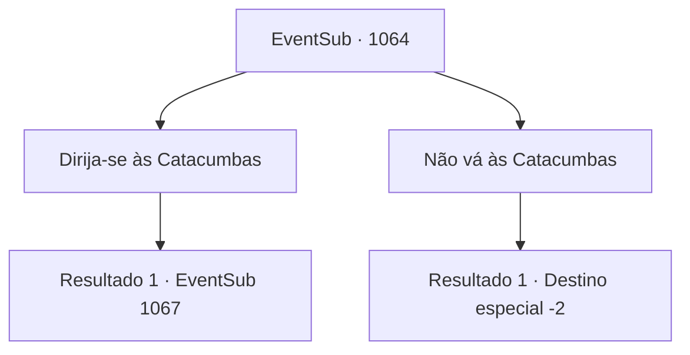

# Eventos secundários · 1064

[Índice da tabela](index.md) · [Índice geral](../index.md)

ID: `pt:EventSub:1064` · Fonte: `EventSub4` · Versão: 1.2.47.

Mapeamento estático dos arquivos; a disponibilidade e a execução dependem do estado da run.

## Texto do evento

*Sem texto no arquivo.*

## Dados de entrada

```json
{
  "id": 1064,
  "grade": 1,
  "subEvent": "",
  "required": ""
}
```

## Mapa das escolhas



## Escolhas e resultados

### Escolha 1

Dirija-se às Catacumbas

Requisitos e outros campos da escolha:

```json
{
  "required": ""
}
```

#### Resultado 1.1

Você se dirige às Catacumbas, onde dizem que Lukas está se escondendo. Lá, você encontra Milorad novamente. Ele sorri, satisfeito. 

 "Eu sabia! Vou assumir a liderança."|drawing_catacomb| Uma enorme colina impede que os raios do sol alcancem este lugar. A área parece sinistra e sombria, e ainda nem era noite. Você segue Milorad até o porão. Ele ilumina o caminho com sua tocha. Você desce na escuridão, tomando a escada de terra pavimentada. A escuridão se intensifica à medida que você desce. Logo, a voz de Lukas ecoa na escuridão. 

 "Milorad. O que significa isso?"

 Em vez de responder, Milorad puxa sua espada longa. Lukas range os dentes e grita em resposta. 

 "Droga... Você me toma por um tolo?! Matem-nos! Matem todos eles!"

 Os cadáveres das Catacumbas respondem às ordens de Lukas. Os esqueletos começam a avançar contra você e Milorad.

Continuação registrada: [Evento 1067](1067.md) na mesma tabela.

```json
{
  "required": "",
  "chance": "1",
  "nextEvent": 1067,
  "type": 2,
  "reward": "6_0_12",
  "place": 7
}
```

### Escolha 2

Não vá às Catacumbas

Requisitos e outros campos da escolha:

```json
{
  "required": ""
}
```

#### Resultado 2.1

Você ignora Milorad e decide não ir às Catacumbas.

Continuação registrada: [Destino especial `-2`](../destinos-especiais.md).

```json
{
  "required": "",
  "chance": "1",
  "nextEvent": -2,
  "type": 2,
  "reward": "12_12_-1"
}
```

## Referências que chegam a este evento

- [Evento 1063 · escolha 2 · resultado 1](1063.md#escolha-2)
