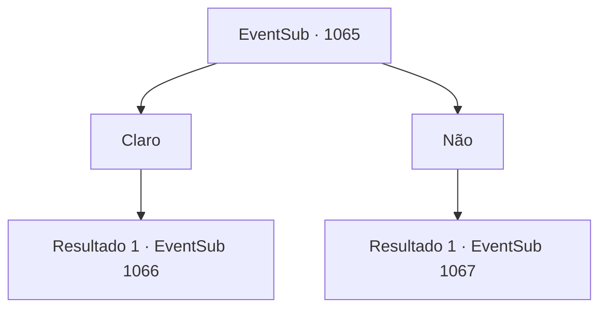

# Eventos secundários · 1065

[Índice da tabela](index.md) · [Índice geral](../index.md)

ID: `pt:EventSub:1065` · Fonte: `EventSub4` · Versão: 1.2.47.

Mapeamento estático dos arquivos; a disponibilidade e a execução dependem do estado da run.

## Texto do evento

*Sem texto no arquivo.*

## Dados de entrada

```json
{
  "id": 1065,
  "grade": 1,
  "subEvent": "",
  "required": ""
}
```

## Mapa das escolhas



## Escolhas e resultados

### Escolha 1

Claro

Requisitos e outros campos da escolha:

```json
{
  "required": ""
}
```

#### Resultado 1.1

Você concorda em amarrar suas mãos, como Milorad sugeriu. Ele amarra um nó frouxo em torno de seus pulsos. Você segue Milorad até o porão. Ele ilumina o caminho com sua tocha. Você desce na escuridão, tomando a escada de terra pavimentada. A escuridão se intensifica à medida que você desce. Logo, a voz de Lukas ecoa da escuridão. 

 "Eu sabia que podia contar com você, Milorad."

 Lukas exibe um sorriso vil e se aproxima de você. 

 "Kyahaha... Nossos planos teriam corrido tão bem sem você. Vou fazer ser doloroso. Vou FAZER você se arrepender de suas escolhas."

 Então, uma sensação fria toca a ponta de suas mãos. Um pequeno punhal cai em seu aperto. Milorad lhe dá um olhar sutil com os olhos. Ele está lhe dando um sinal com as sobrancelhas.

Continuação registrada: [Evento 1066](1066.md) na mesma tabela.

```json
{
  "required": "",
  "chance": "1",
  "nextEvent": 1066,
  "type": 2,
  "reward": "3_0_1"
}
```

### Escolha 2

Não

Requisitos e outros campos da escolha:

```json
{
  "required": ""
}
```

#### Resultado 2.1

Milorad não insiste na ideia. 

 "Você ainda não confia o suficiente em mim. Eu entendo."

 Você segue Milorad até o porão. Ele ilumina o caminho com sua tocha. Você desce na escuridão, tomando a escada de terra pavimentada. A escuridão se intensifica à medida que você desce. Logo, a voz de Lukas ecoa na escuridão. 

 "Milorad. O que significa isso?"

 Em vez de responder, Milorad puxa sua espada longa. Lukas range os dentes e grita em resposta. 

 "Droga... Você me toma por um tolo?! Matem-nos! Matem todos eles!"

 Os cadáveres das Catacumbas respondem às ordens de Lukas. Os esqueletos começam a atacar você e Milorad.

Continuação registrada: [Evento 1067](1067.md) na mesma tabela.

```json
{
  "required": "",
  "chance": "1",
  "nextEvent": 1067,
  "type": 2,
  "reward": "6_0_12",
  "place": 7
}
```

## Referências que chegam a este evento

- [Evento 1063 · escolha 1 · resultado 1](1063.md#escolha-1)
