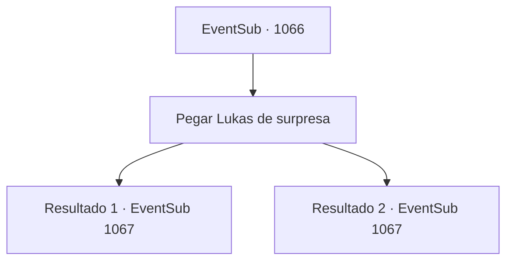

# Eventos secundários · 1066

[Índice da tabela](index.md) · [Índice geral](../index.md)

ID: `pt:EventSub:1066` · Fonte: `EventSub4` · Versão: 1.2.47.

Mapeamento estático dos arquivos; a disponibilidade e a execução dependem do estado da run.

## Texto do evento

*Sem texto no arquivo.*

## Dados de entrada

```json
{
  "id": 1066,
  "grade": 1,
  "subEvent": "",
  "required": ""
}
```

## Mapa das escolhas



## Escolhas e resultados

### Escolha 1

Pegar Lukas de surpresa

Requisitos e outros campos da escolha:

```json
{
  "required": ""
}
```

#### Resultado 1.1

Você corta o nó em torno de suas mãos e apunhala Lukas com a adaga. 

 "ACK--! AAAARRRGHH!!!"

 Lukas grita roucamente e cai no chão. Ele se arrasta para longe de vocês dois desesperadamente. 

 "C- como...! MILORAD! P- POR QUE VOCÊ ESTÁ FAZENDO ISSO?"

 Sua expressão grita dor e confusão. Milorad olha para ele friamente e murmura. 

 "Se você deseja viver, escreverá o que eu lhe disser."

 Mas Lukas o ignora. 

 "Droga... Você me toma por um idiota?! Matem-nos! Matem todos eles!"

 Os cadáveres das Catacumbas respondem às ordens de Lukas. Os esqueletos começam a avançar contra você e Milorad.

Continuação registrada: [Evento 1067](1067.md) na mesma tabela.

```json
{
  "required": "",
  "chance": "1|0_6_1",
  "nextEvent": 1067,
  "type": 0,
  "reward": "6_2_12",
  "place": 7
}
```

#### Resultado 1.2

Mas Lukas é mais rápido do que você espera. Depois de desviar do seu ataque, ele range os dentes e grita. 

 "Droga... Você me acha um idiota?! Matem-nos! Matem todos eles!"

 Os cadáveres das Catacumbas respondem às ordens de Lukas. Os esqueletos começam a avançar contra você e Milorad.

Continuação registrada: [Evento 1067](1067.md) na mesma tabela.

```json
{
  "required": "",
  "chance": "14",
  "nextEvent": 1067,
  "type": 1,
  "reward": "6_0_12",
  "place": 7
}
```

## Referências que chegam a este evento

- [Evento 1065 · escolha 1 · resultado 1](1065.md#escolha-1)
