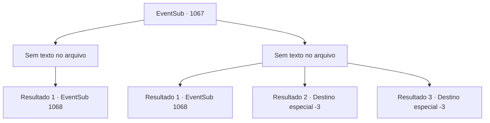

# Eventos secundários · 1067

[Índice da tabela](index.md) · [Índice geral](../index.md)

ID: `pt:EventSub:1067` · Fonte: `EventSub4` · Versão: 1.2.47.

Mapeamento estático dos arquivos; a disponibilidade e a execução dependem do estado da run.

## Texto do evento

*Sem texto no arquivo.*

## Dados de entrada

```json
{
  "id": 1067,
  "grade": 1,
  "subEvent": "",
  "required": ""
}
```

## Mapa das escolhas



## Escolhas e resultados

### Escolha 1

*Sem texto no arquivo; o papel dessa opção depende da interface do jogo.*

Requisitos e outros campos da escolha:

```json
{
  "required": ""
}
```

#### Resultado 1.1

Você e Milorad colocam os mortos para descansar mais uma vez.   Os esqueletos se despedaçam e colapsam no chão.   

 "Isso ainda não acabou. Mantenha-se alerta."

   Assim que Milorad diz isso, os ossos despedaçados começam a convergir em uma grande pilha.   <color=red><link=shake>

 "GROH---!!"

</link></color>   Os restos se tornam um gigantesco Necrotitã.   Rugindo, ele ataca você com seus punhos colossais.

Continuação registrada: [Evento 1068](1068.md) na mesma tabela.

```json
{
  "required": "",
  "chance": "1",
  "nextEvent": 1068,
  "type": 2,
  "reward": "6_0_184",
  "place": 7
}
```

### Escolha 2

*Sem texto no arquivo; o papel dessa opção depende da interface do jogo.*

Requisitos e outros campos da escolha:

```json
{
  "required": ""
}
```

#### Resultado 2.1

Os esqueletos te encurralam no chão. Então, Milorad vem em seu auxílio, destruindo os esqueletos com sua espada larga. Os esqueletos se despedaçam e caem no chão. Ele te ajuda a se levantar e continua. 

 "Isso ainda não acabou. Mantenha-se alerta."

 Assim que Milorad diz isso, os ossos despedaçados começam a convergir em uma grande pilha. <color=red><link=shake>

 "GROH---!!"

</link></color> Os restos se tornam um gigantesco Necrotitã. Rugindo, ele te ataca com seus punhos colossais.

Continuação registrada: [Evento 1068](1068.md) na mesma tabela.

```json
{
  "required": "1_0_2|1_1_2",
  "chance": "1",
  "nextEvent": 1068,
  "type": 2,
  "reward": "6_0_184|0_0_-1|0_1_-1",
  "place": 7
}
```

#### Resultado 2.2

Os esqueletos te encurralam no chão. Um deles dá o golpe final. Infelizmente, você se junta às fileiras dos mortos.

Continuação registrada: [Destino especial `-3`](../destinos-especiais.md).

```json
{
  "required": "2_0_2",
  "chance": "1",
  "nextEvent": -3,
  "type": 2,
  "reward": "0_0_-1|0_1_-1"
}
```

#### Resultado 2.3

Os esqueletos te encurralam no chão. Um deles dá o golpe final. Infelizmente, você se junta às fileiras dos mortos.

Continuação registrada: [Destino especial `-3`](../destinos-especiais.md).

```json
{
  "required": "2_1_2",
  "chance": "1",
  "nextEvent": -3,
  "type": 2,
  "reward": "0_0_-1|0_1_-1"
}
```

## Referências que chegam a este evento

- [Evento 1064 · escolha 1 · resultado 1](1064.md#escolha-1)
- [Evento 1065 · escolha 2 · resultado 1](1065.md#escolha-2)
- [Evento 1066 · escolha 1 · resultado 1](1066.md#escolha-1)
- [Evento 1066 · escolha 1 · resultado 2](1066.md#escolha-1)
- [Evento 1075 · escolha 1 · resultado 1](1075.md#escolha-1)
