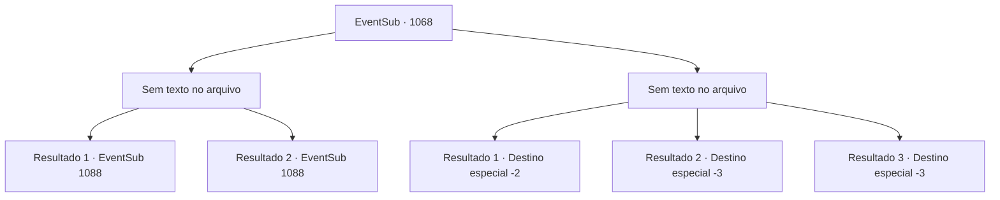

# Eventos secundários · 1068

[Índice da tabela](index.md) · [Índice geral](../index.md)

ID: `pt:EventSub:1068` · Fonte: `EventSub4` · Versão: 1.2.47.

Mapeamento estático dos arquivos; a disponibilidade e a execução dependem do estado da run.

## Texto do evento

*Sem texto no arquivo.*

## Dados de entrada

```json
{
  "id": 1068,
  "grade": 1,
  "subEvent": "",
  "required": ""
}
```

## Mapa das escolhas



## Escolhas e resultados

### Escolha 1

*Sem texto no arquivo; o papel dessa opção depende da interface do jogo.*

Requisitos e outros campos da escolha:

```json
{
  "required": ""
}
```

#### Resultado 1.1

O Necrotitan perde seu poder e desmorona. Agora, não é nada além de uma pilha de fragmentos de ossos inanimados. Lukas, apavorado, tenta fugir. Mas Milorad o captura. Ele 'dá uma lição' em Lukas algumas vezes, depois é jogado no chão. 

 "Ugh! Ack! P- por favor... MISERICÓRDIA...!"

 Lukas começa a implorar como uma mosca. Milorad responde. 

 "Se você deseja manter esse pescoço conectado ao seu corpo, você escreverá o que eu lhe disser."

 Lukas acena com a cabeça, tremendo. Milorad joga para ele um pedaço de pergaminho e uma pena. 

 "Eu, Lukas, manipulei Hazel com feitiçaria maligna. Em relação ao sequestro de Edward, eu sou o único culpado. Lamento profundamente tudo o que fiz e..."

 Milorad continua, pressionando a cabeça de Lukas com sua bota. 

 "...nunca mais mostrarei meu rosto no Condado de Ronan."

 Lukas escreve tudo, ainda tremendo. Ele acrescenta que nunca sequer considerará fazer algo assim no futuro. 

 "Você nunca mais me verá, Senhor Milorad. Então, por favor..."

 Então, Milorad puxa uma corda e a amarra em volta do pescoço de Lukas.

Continuação registrada: [Evento 1088](1088.md) na mesma tabela.

```json
{
  "required": "18_822_1",
  "chance": "1",
  "nextEvent": 1088,
  "type": 2,
  "reward": ""
}
```

#### Resultado 1.2

O Necrotitan perde seu poder e desmorona. Agora, não é nada além de uma pilha de fragmentos de ossos inanimados. Lukas, apavorado, tenta fugir. Mas Milorad o captura. Ele 'dá uma lição' em Lukas algumas vezes, depois é jogado no chão. 

 "Ugh! Ack! P- por favor... MISERICÓRDIA...!"

 Lukas começa a implorar como uma mosca. Milorad responde. 

 "Se você deseja manter esse pescoço conectado ao seu corpo, você escreverá o que eu lhe disser."

 Lukas acena com a cabeça, tremendo. Milorad joga para ele um pedaço de pergaminho e uma pena. 

 "Eu, Lukas, manipulei Hazel com feitiçaria maligna. Em relação ao sequestro de Edward, eu sou o único culpado. Lamento profundamente tudo o que fiz e..."

 Milorad continua, pressionando a cabeça de Lukas com sua bota. 

 "...nunca mais mostrarei meu rosto no Condado de Ronan."

 Lukas escreve tudo, ainda tremendo. Ele acrescenta que nunca sequer considerará fazer algo assim no futuro. 

 "Você nunca mais me verá, Senhor Milorad. Então, por favor..."

 Então, Milorad puxa uma corda e a amarra em volta do pescoço de Lukas.

Continuação registrada: [Evento 1088](1088.md) na mesma tabela.

```json
{
  "required": "5_822_1",
  "chance": "1",
  "nextEvent": 1088,
  "type": 2,
  "reward": ""
}
```

### Escolha 2

*Sem texto no arquivo; o papel dessa opção depende da interface do jogo.*

Requisitos e outros campos da escolha:

```json
{
  "required": ""
}
```

#### Resultado 2.1

O Necrotitan te lança e a Milorad pelos ares com seus punhos. Com um estrondo alto, ele envia um impacto para toda a Catacumba, que começa a tremer. As rachaduras começam a se espalhar. Escombros começam a cair do teto. Incapaz de suportar a temível batalha, a própria Catacumba está desmoronando. Você mal consegue se levantar e encontrar uma saída. Apenas mais alguns segundos e você teria sido pego nos escombros. Não muito tempo depois, toda a estrutura desaparece. Parece que você é o único que conseguiu sair em segurança. Você dá uma olhada ao redor da área e então vai embora.

Continuação registrada: [Destino especial `-2`](../destinos-especiais.md).

```json
{
  "required": "1_0_2|1_1_2",
  "chance": "1",
  "nextEvent": -2,
  "type": 2,
  "reward": "12_12_-1|0_0_-1|0_1_-1|14_12_11"
}
```

#### Resultado 2.2

O Necrotitan te lança e a Milorad pelos ares com seus punhos. Com um estrondo alto, ele envia um impacto para toda a Catacumba, que começa a tremer. As rachaduras começam a se espalhar. Escombros começam a cair do teto. Sem forças restantes, você não consegue se levantar enquanto é coberto por destroços.

Continuação registrada: [Destino especial `-3`](../destinos-especiais.md).

```json
{
  "required": "2_0_2",
  "chance": "1",
  "nextEvent": -3,
  "type": 2,
  "reward": "0_0_-1|0_1_-1"
}
```

#### Resultado 2.3

O Necrotitan te lança e a Milorad pelos ares com seus punhos. Com um estrondo alto, ele envia um impacto para toda a Catacumba, que começa a tremer. As rachaduras começam a se espalhar. Escombros começam a cair do teto. Sem forças restantes, você não consegue se levantar enquanto é coberto por destroços.

Continuação registrada: [Destino especial `-3`](../destinos-especiais.md).

```json
{
  "required": "2_1_2",
  "chance": "1",
  "nextEvent": -3,
  "type": 2,
  "reward": "0_0_-1|0_1_-1"
}
```

## Referências que chegam a este evento

- [Evento 1067 · escolha 1 · resultado 1](1067.md#escolha-1)
- [Evento 1067 · escolha 2 · resultado 1](1067.md#escolha-2)
