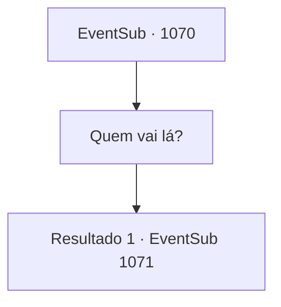

# Eventos secundários · 1070

[Índice da tabela](index.md) · [Índice geral](../index.md)

ID: `pt:EventSub:1070` · Fonte: `EventSub4` · Versão: 1.2.47.

Mapeamento estático dos arquivos; a disponibilidade e a execução dependem do estado da run.

## Texto do evento

Seguindo a pista sobre o paradeiro de Lukas, você monta uma pequena tenda perto da margem do rio e acende uma pequena fogueira. O sol está se pondo, e não há nenhum assentamento à vista nas proximidades. Não muito tempo depois, alguém se aproxima de você. 

 "Você é {1}, correto?"


## Dados de entrada

```json
{
  "id": 1070,
  "grade": 1,
  "subEvent": "",
  "required": "12_12_8|1_2_30"
}
```

## Mapa das escolhas



## Escolhas e resultados

### Escolha 1

Quem vai lá?

Requisitos e outros campos da escolha:

```json
{
  "required": ""
}
```

#### Resultado 1.1

É um homem com um capuz preto. Ele fala com uma voz baixa e gutural. Através do capuz, você nota seu cabelo castanho, barba desgrenhada e algumas cicatrizes. 

 "Meu nome é Milorad. Sou o irmão mais velho de Hazel Ronan, a segunda esposa do Conde."

 Ele olha nos seus olhos e continua. 

 "Hazel está na prisão. Graças a você."


Continuação registrada: [Evento 1071](1071.md) na mesma tabela.

```json
{
  "required": "",
  "chance": "1",
  "nextEvent": 1071,
  "type": 2,
  "reward": ""
}
```

## Referências que chegam a este evento

Nenhum `nextEvent` positivo da mesma tabela aponta para este nó. Isso não prova que seja inacessível: sorteio e estado de história podem selecioná-lo.

