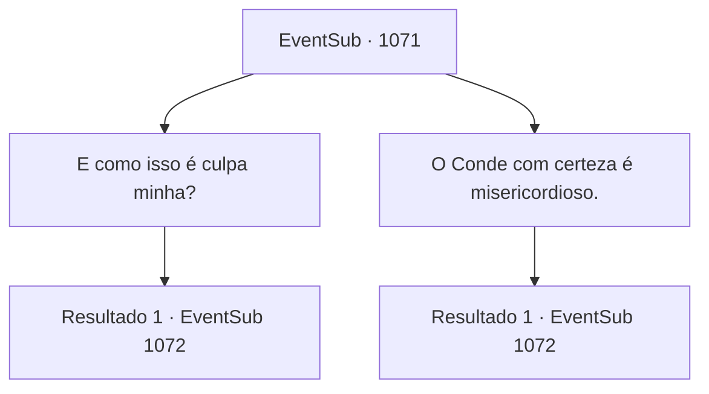

# Eventos secundários · 1071

[Índice da tabela](index.md) · [Índice geral](../index.md)

ID: `pt:EventSub:1071` · Fonte: `EventSub4` · Versão: 1.2.47.

Mapeamento estático dos arquivos; a disponibilidade e a execução dependem do estado da run.

## Texto do evento

*Sem texto no arquivo.*

## Dados de entrada

```json
{
  "id": 1071,
  "grade": 1,
  "subEvent": "",
  "required": ""
}
```

## Mapa das escolhas



## Escolhas e resultados

### Escolha 1

E como isso é culpa minha?

Requisitos e outros campos da escolha:

```json
{
  "required": ""
}
```

#### Resultado 1.1

Milorad dá de ombros em resposta. 

 "Bem... Eu não estou exatamente te culpando por isso. Também não vim até aqui para lutar com você."

 Você pergunta a ele, então, qual é exatamente o propósito de sua visita. Ele dá uma risada de desdém, então responde. 

 "Eu preciso de alguém para acabar com a vida de Lukas. E gostaria que você fizesse isso."


Continuação registrada: [Evento 1072](1072.md) na mesma tabela.

```json
{
  "required": "",
  "chance": "1",
  "nextEvent": 1072,
  "type": 2,
  "reward": ""
}
```

### Escolha 2

O Conde com certeza é misericordioso.

Requisitos e outros campos da escolha:

```json
{
  "required": ""
}
```

#### Resultado 2.1

Milorad acena em concordância. 

 "Ponto válido. Ao contrário de sua aparência, o Conde Ronan é de fato um homem de emoção."

 Ele olha você de cima a baixo, então continua. 

 "Preciso de alguém para acabar com a vida de Lukas. E gostaria que você fizesse isso."


Continuação registrada: [Evento 1072](1072.md) na mesma tabela.

```json
{
  "required": "",
  "chance": "1",
  "nextEvent": 1072,
  "type": 2,
  "reward": ""
}
```

## Referências que chegam a este evento

- [Evento 1070 · escolha 1 · resultado 1](1070.md#escolha-1)
