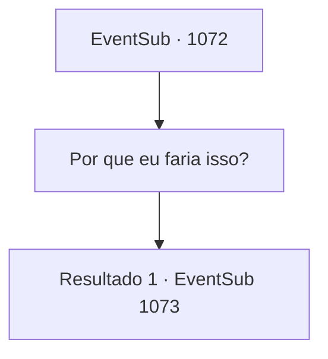

# Eventos secundários · 1072

[Índice da tabela](index.md) · [Índice geral](../index.md)

ID: `pt:EventSub:1072` · Fonte: `EventSub4` · Versão: 1.2.47.

Mapeamento estático dos arquivos; a disponibilidade e a execução dependem do estado da run.

## Texto do evento

*Sem texto no arquivo.*

## Dados de entrada

```json
{
  "id": 1072,
  "grade": 1,
  "subEvent": "",
  "required": ""
}
```

## Mapa das escolhas



## Escolhas e resultados

### Escolha 1

Por que eu faria isso?

Requisitos e outros campos da escolha:

```json
{
  "required": ""
}
```

#### Resultado 1.1

Ouvi dizer que você é um aventureiro habilidoso. Com seu próprio ódio pessoal por Lukas. Se você recusar, não vou insistir mais. Ele acrescenta que, se você decidir ajudá-lo, ele pessoalmente lhe dará uma arma que seria suficiente como pagamento.

Continuação registrada: [Evento 1073](1073.md) na mesma tabela.

```json
{
  "required": "",
  "chance": "1",
  "nextEvent": 1073,
  "type": 2,
  "reward": "5_822_1"
}
```

## Referências que chegam a este evento

- [Evento 1071 · escolha 1 · resultado 1](1071.md#escolha-1)
- [Evento 1071 · escolha 2 · resultado 1](1071.md#escolha-2)
