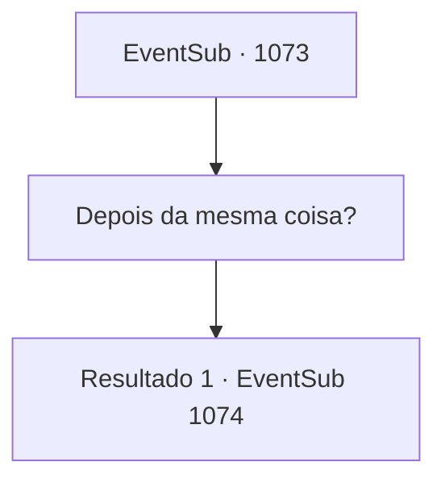

# Eventos secundários · 1073

[Índice da tabela](index.md) · [Índice geral](../index.md)

ID: `pt:EventSub:1073` · Fonte: `EventSub4` · Versão: 1.2.47.

Mapeamento estático dos arquivos; a disponibilidade e a execução dependem do estado da run.

## Texto do evento

*Sem texto no arquivo.*

## Dados de entrada

```json
{
  "id": 1073,
  "grade": 1,
  "subEvent": "",
  "required": ""
}
```

## Mapa das escolhas



## Escolhas e resultados

### Escolha 1

Depois da mesma coisa?

Requisitos e outros campos da escolha:

```json
{
  "required": ""
}
```

#### Resultado 1.1

Milorad acena com a cabeça. 

 "Sim. Compartilhamos um objetivo comum. A morte de Lukas."

 Ele solta um longo suspiro e continua. 

 "Aquele covarde cruzou oficialmente a linha. E agora todos sabem o que ele fez. Se o status quo continuar, Hazel enfrentará um julgamento em breve."

 Milorad respira fundo, como se para suprimir sua raiva. 

 "Primeiro, Hazel será exilada da casa, e depois irá direto para a forca. Tsch. Como ela se envolveu com aquele covarde também é um mistério para mim."

 Ele faz uma expressão amarga, depois acrescenta com uma voz determinada. 

 "De qualquer forma. Eu devo matar Lukas e incriminá-lo por tudo. Essa é a única maneira de salvar minha irmã idiota."


Continuação registrada: [Evento 1074](1074.md) na mesma tabela.

```json
{
  "required": "",
  "chance": "1",
  "nextEvent": 1074,
  "type": 2,
  "reward": ""
}
```

## Referências que chegam a este evento

- [Evento 1072 · escolha 1 · resultado 1](1072.md#escolha-1)
