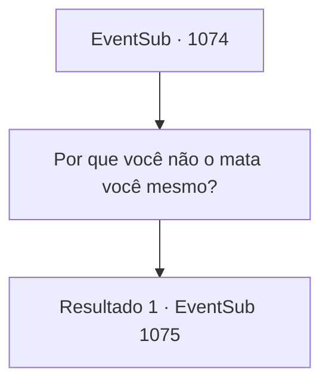

# Eventos secundários · 1074

[Índice da tabela](index.md) · [Índice geral](../index.md)

ID: `pt:EventSub:1074` · Fonte: `EventSub4` · Versão: 1.2.47.

Mapeamento estático dos arquivos; a disponibilidade e a execução dependem do estado da run.

## Texto do evento

*Sem texto no arquivo.*

## Dados de entrada

```json
{
  "id": 1074,
  "grade": 1,
  "subEvent": "",
  "required": ""
}
```

## Mapa das escolhas



## Escolhas e resultados

### Escolha 1

Por que você não o mata você mesmo?

Requisitos e outros campos da escolha:

```json
{
  "required": ""
}
```

#### Resultado 1.1

Você responde imediatamente em um tom irritado. Milorad suspira novamente. 

 "Duas razões pelas quais não posso fazer isso sozinho. Primeiro, não quero que minha irmã me odeie. Segundo, Lukas comanda uma criatura invocada que é, no mínimo, tão forte quanto eu."

 Ele para por um breve momento antes de continuar. 

 "Então, acho que estaríamos ajudando um ao outro. Uma situação em que ambos ganham, não acha?"


Continuação registrada: [Evento 1075](1075.md) na mesma tabela.

```json
{
  "required": "",
  "chance": "1",
  "nextEvent": 1075,
  "type": 2,
  "reward": ""
}
```

## Referências que chegam a este evento

- [Evento 1073 · escolha 1 · resultado 1](1073.md#escolha-1)
