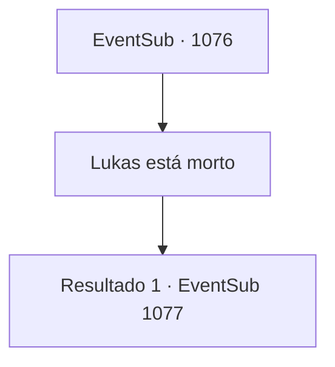

# Eventos secundários · 1076

[Índice da tabela](index.md) · [Índice geral](../index.md)

ID: `pt:EventSub:1076` · Fonte: `EventSub4` · Versão: 1.2.47.

Mapeamento estático dos arquivos; a disponibilidade e a execução dependem do estado da run.

## Texto do evento

Você vai ao castelo do Conde, onde Lupin está hospedado, para relatar a morte de Lukas. |drawing_Rouent| Sentado no topo da colina está o castelo do Conde - um mirante com uma bela vista de toda Rouent. Enquanto você está subindo para o castelo, encontra um grupo de cavaleiros conversando. Um deles é Lupin. Ele pede um minuto aos seus companheiros cavaleiros e então se aproxima de você. 

 "Como foi?"


## Dados de entrada

```json
{
  "id": 1076,
  "grade": 2,
  "subEvent": "",
  "required": "12_12_9|1_2_45"
}
```

## Mapa das escolhas



## Escolhas e resultados

### Escolha 1

Lukas está morto

Requisitos e outros campos da escolha:

```json
{
  "required": ""
}
```

#### Resultado 1.1

Você e Lupin vão para o castelo do Conde, e no caminho você conta a ele tudo o que aconteceu. Vocês dois se dirigem à sala de audiências, onde o Conde está esperando. Lupin ouve sua história ativamente. 

 "Então é isso que realmente aconteceu... Bem, é uma boa notícia que Lukas finalmente recebeu o que merecia."

 A pesada porta se abre. Você entra no salão espaçoso. Paredes de pedra fria cobrem a área, com um lustre de ferro pendurado no teto, emitindo uma luz fraca. No final do salão há uma fundação elevada, no topo da qual estão três cadeiras luxuosas. Sentado na cadeira do centro está ninguém menos que o próprio Conde Ronan. Você se aproxima do Conde e mostra respeito. O Conde começa agradecendo você. 

 "Obrigado, do fundo do meu coração, por salvar meu filho. E graças a você, consegui descobrir o esquema de Hazel e Lukas também! Ainda não sei como posso te agradecer o suficiente."

 Ele pede para você esperar, então volta com uma lança de aparência luxuosa. 

 "Obrigado mais uma vez, {1}. Minha Casa não é exatamente conhecida por suas riquezas, mas temos raízes que remontam a uma linhagem de um grande guerreiro. História de orgulho, eu diria."

 Ele continua, mostrando a você a relíquia de família. 

 "Aqui - uma lança ancestral, passada por gerações. Ah, e se você tiver tempo, fique. Tenho certeza de que você poderia usar uma pausa de suas viagens e aventuras. Edward ficaria feliz em vê-lo novamente também."


Continuação registrada: [Evento 1077](1077.md) na mesma tabela.

```json
{
  "required": "",
  "chance": "1",
  "nextEvent": 1077,
  "type": 2,
  "reward": "3_367_1|12_12_-1|14_12_1|14_12_2"
}
```

## Referências que chegam a este evento

Nenhum `nextEvent` positivo da mesma tabela aponta para este nó. Isso não prova que seja inacessível: sorteio e estado de história podem selecioná-lo.

