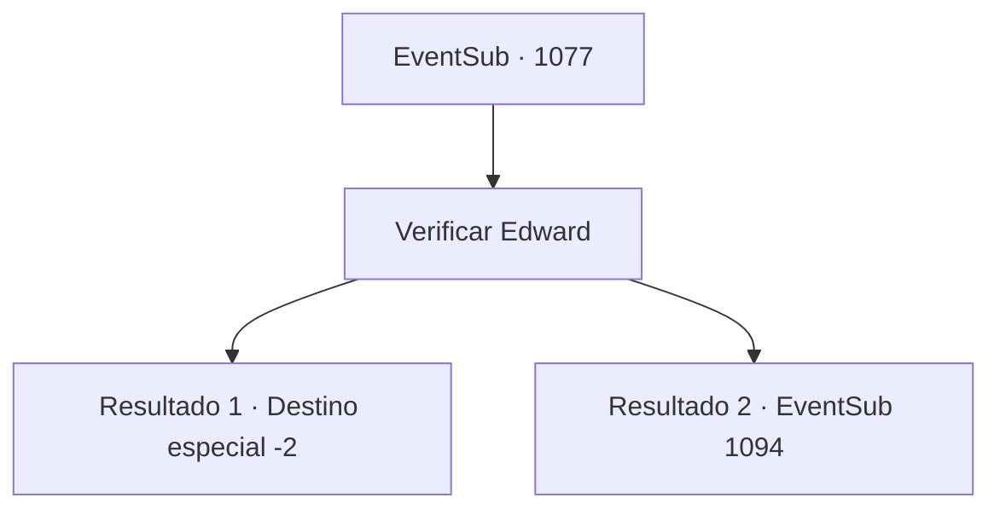

# Eventos secundários · 1077

[Índice da tabela](index.md) · [Índice geral](../index.md)

ID: `pt:EventSub:1077` · Fonte: `EventSub4` · Versão: 1.2.47.

Mapeamento estático dos arquivos; a disponibilidade e a execução dependem do estado da run.

## Texto do evento

*Sem texto no arquivo.*

## Dados de entrada

```json
{
  "id": 1077,
  "grade": 1,
  "subEvent": "",
  "required": ""
}
```

## Mapa das escolhas



## Escolhas e resultados

### Escolha 1

Verificar Edward

Requisitos e outros campos da escolha:

```json
{
  "required": ""
}
```

#### Resultado 1.1

O próprio Conde o acompanha pelo castelo e até os jardins. Você encontra a Condessa e Edward em um canteiro de flores bem organizado. Edward parece ter ganhado algum peso extra, parecendo muito melhor do que antes. 

 "Meu amor? Este é o salvador do nosso menino. {1}? Esta aqui é minha esposa, Irema."

 Quando o Conde termina as apresentações, a Condessa Irema se inclina graciosamente diante de você. 

 "Obrigada... obrigada."

 Os olhos dela já estão molhados. Sua voz também treme. Edward se aproxima de você e também se inclina. 

 "O- obrigado..."

 Você conhece a família do Conde e se junta a eles para uma refeição. Depois, você descansa merecidamente nos luxuosos aposentos de hóspedes. No dia seguinte, quando você está prestes a retornar às suas aventuras, o Conde e sua família saem para se despedir. 

 "Adeus! Mantenha-se saudável!"

 Todos acenam para você em despedida. Você faz o mesmo e deixa os terrenos do castelo.

Continuação registrada: [Destino especial `-2`](../destinos-especiais.md).

```json
{
  "required": "18_792_1",
  "chance": "1",
  "nextEvent": -2,
  "type": 2,
  "reward": "0_0_1|0_1_1"
}
```

#### Resultado 1.2

O próprio Conde o acompanha pelo castelo e até os jardins. Você encontra a Condessa, Edward e Erina em um canteiro de flores bem organizado. Edward parece ter ganhado algum peso extra, parecendo muito melhor do que antes. Erina não mudou nada - ela ainda é a criança brincalhona e energética. 

 "Meu amor? Este é o salvador do nosso menino. {1}? Esta aqui é minha esposa, Irema."

 Quando o Conde termina as apresentações, a Condessa Irema se inclina graciosamente diante de você. 

 "Obrigada... obrigada."

 Os olhos dela já estão molhados. Sua voz também treme. Edward se aproxima de você e se inclina. 

 "O- obrigado..."

 Erina faz uma saudação nobre desajeitada, mas aceitável. Irema deve tê-la ensinado. 

 "Faz tanto tempo!"

 Enquanto Edward brinca com Erina, o Conde e sua esposa o tratam com uma refeição requintada.

Continuação registrada: [Evento 1094](1094.md) na mesma tabela.

```json
{
  "required": "5_792_1",
  "chance": "1",
  "nextEvent": 1094,
  "type": 2,
  "reward": ""
}
```

## Referências que chegam a este evento

- [Evento 1076 · escolha 1 · resultado 1](1076.md#escolha-1)
- [Evento 1092 · escolha 1 · resultado 1](1092.md#escolha-1)
