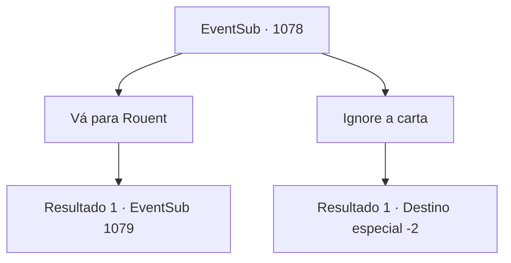

# Eventos secundários · 1078

[Índice da tabela](index.md) · [Índice geral](../index.md)

ID: `pt:EventSub:1078` · Fonte: `EventSub4` · Versão: 1.2.47.

Mapeamento estático dos arquivos; a disponibilidade e a execução dependem do estado da run.

## Texto do evento

Um pombo voa ruidosamente em sua direção. Amarrado em seu pescoço está um lenço inscrito com um tridente azul - o símbolo da Casa Ronan. Você estende o braço, para que o pombo possa pousar sobre ele. 

 "Coo coo... coo coo."

 O pombo se acomoda. Cuidadosamente, você desamarra a carta presa em seus pés. A carta é de Lupin.
 'O Conde insistiu em encontrá-lo pessoalmente. Encontre-me na ponte sobre o rio em Rouent, a capital do Condado de Ronan. Avisarei os guardas com antecedência.'
 Tendo completado sua missão, o pombo abre as asas novamente e alça voo. Você o observa silenciosamente voar para longe nos céus.

## Dados de entrada

```json
{
  "id": 1078,
  "grade": 1,
  "subEvent": "",
  "required": "12_12_5|1_2_35"
}
```

## Mapa das escolhas



## Escolhas e resultados

### Escolha 1

Vá para Rouent

Requisitos e outros campos da escolha:

```json
{
  "required": ""
}
```

#### Resultado 1.1

|drawing_Rouent| Após alguns dias de viagem, você chega à cidade capital do Condado de Ronan, 'Rouent'. Os guardas da cidade imediatamente reconhecem seu rosto e o deixam entrar sem inspeção. Ao passar pelas grossas muralhas da cidade, uma rua principal bem polida, pontilhada de edifícios coloridos, o recebe. Você segue a rua principal, tentando encontrar a ponte que Lupin mencionou. Um rio, com cerca de trinta metros de largura, atravessa o coração da cidade. Você caminha até a ponte sobre o grande riacho e espera por Lupin lá.  Pouco tempo depois, enquanto você observa as trutas saltando na água, um cavaleiro familiar se aproxima de você. Ele acena com as mãos para cumprimentá-lo e imediatamente vai direto ao ponto. 

 "O Conde está esperando por você. Vamos."

 Lupin o leva à sala de audiências do castelo, onde o Conde está esperando.  A pesada porta se abre. Você entra no salão espaçoso. Paredes de pedra fria cobrem a área, com um lustre de ferro pendurado no teto, emitindo uma luz tênue. No final do salão há uma fundação elevada, sobre a qual estão três cadeiras luxuosas. Sentado na cadeira do centro está ninguém menos que o próprio Conde Ronan. Você se aproxima do Conde e mostra respeito. O Conde começa agradecendo. 

 "Obrigado, do fundo do meu coração, por salvar meu filho. E graças a você, consegui descobrir o esquema de Hazel e Lukas também! Ainda não sei como posso agradecê-lo o suficiente."

 Ele pede que você espere, depois volta com uma lança de aparência luxuosa. 

 "Obrigado mais uma vez, {1}. Minha Casa não é exatamente conhecida por suas riquezas, mas temos raízes que remontam a uma linhagem de um grande guerreiro. História orgulhosa, eu diria."

 Ele continua, mostrando-lhe a relíquia de família. 

 "Aqui - uma lança ancestral, passada por gerações. Ah, e se você tiver tempo, fique. Tenho certeza de que você poderia usar uma pausa de suas viagens e aventuras. Edward ficaria feliz em vê-lo novamente também."


Continuação registrada: [Evento 1079](1079.md) na mesma tabela.

```json
{
  "required": "",
  "chance": "1",
  "nextEvent": 1079,
  "type": 2,
  "reward": ""
}
```

### Escolha 2

Ignore a carta

Requisitos e outros campos da escolha:

```json
{
  "required": ""
}
```

#### Resultado 2.1

Você ignora a carta de Lupin.

Continuação registrada: [Destino especial `-2`](../destinos-especiais.md).

```json
{
  "required": "",
  "chance": "1",
  "nextEvent": -2,
  "type": 2,
  "reward": "12_12_-1"
}
```

## Referências que chegam a este evento

Nenhum `nextEvent` positivo da mesma tabela aponta para este nó. Isso não prova que seja inacessível: sorteio e estado de história podem selecioná-lo.

