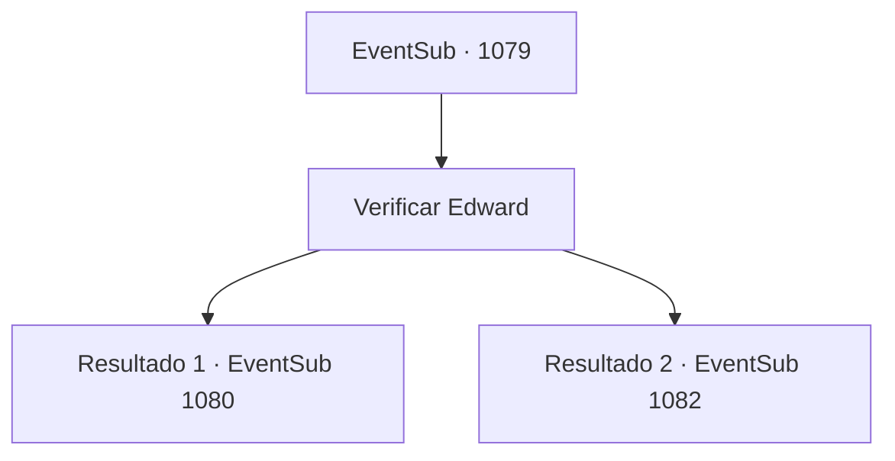

# Eventos secundários · 1079

[Índice da tabela](index.md) · [Índice geral](../index.md)

ID: `pt:EventSub:1079` · Fonte: `EventSub4` · Versão: 1.2.47.

Mapeamento estático dos arquivos; a disponibilidade e a execução dependem do estado da run.

## Texto do evento

*Sem texto no arquivo.*

## Dados de entrada

```json
{
  "id": 1079,
  "grade": 1,
  "subEvent": "",
  "required": ""
}
```

## Mapa das escolhas



## Escolhas e resultados

### Escolha 1

Verificar Edward

Requisitos e outros campos da escolha:

```json
{
  "required": ""
}
```

#### Resultado 1.1

O próprio Conde o acompanha pelo castelo até o campo de treinamento. Lá, você encontra a Condessa e Edward em um ambiente bem organizado. Edward parece muito mais saudável do que antes. Mesmo agora, ele está praticando com uma lança de madeira. 

 "Meu amor? Este é o salvador do nosso menino. {1}? Esta aqui é minha esposa, Irema."

 Quando o Conde termina as apresentações, a Condessa Irema se inclina graciosamente diante de você. 

 "Obrigada... obrigada."

 Seus olhos já estão molhados. Sua voz também treme. Edward se aproxima de você e também se inclina. 

 "Obrigado... Mas, eu tenho um pedido."

 A Condessa parece surpresa ao ouvir isso de Edward.

Continuação registrada: [Evento 1080](1080.md) na mesma tabela.

```json
{
  "required": "5_770_1",
  "chance": "1",
  "nextEvent": 1080,
  "type": 2,
  "reward": "3_367_1"
}
```

#### Resultado 1.2

O próprio Conde o acompanha pelo castelo e até os jardins. Você encontra a Condessa e Edward em um canteiro de flores bem organizado. Edward parece ter ganhado algum peso extra, parecendo muito melhor do que antes. 

 "Meu amor? Este é o salvador do nosso menino. {1}? Esta aqui é minha esposa, Irema."

 Quando o Conde termina as apresentações, a Condessa Irema se inclina graciosamente diante de você. 

 "Obrigada... obrigada."

 Os olhos dela já estão molhados. Sua voz também treme. Edward se aproxima de você e também se inclina. 

 "O- obrigado... Mas... uh, posso ter uma palavra com você?"

 A Condessa parece surpresa ao ouvir isso de Edward.

Continuação registrada: [Evento 1082](1082.md) na mesma tabela.

```json
{
  "required": "5_770_2",
  "chance": "1",
  "nextEvent": 1082,
  "type": 2,
  "reward": "3_367_1"
}
```

## Referências que chegam a este evento

- [Evento 1078 · escolha 1 · resultado 1](1078.md#escolha-1)
