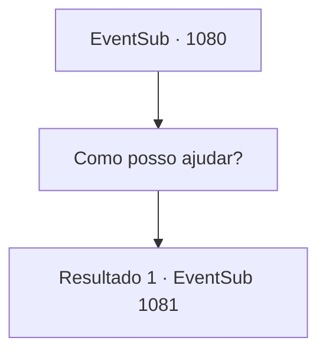

# Eventos secundários · 1080

[Índice da tabela](index.md) · [Índice geral](../index.md)

ID: `pt:EventSub:1080` · Fonte: `EventSub4` · Versão: 1.2.47.

Mapeamento estático dos arquivos; a disponibilidade e a execução dependem do estado da run.

## Texto do evento

*Sem texto no arquivo.*

## Dados de entrada

```json
{
  "id": 1080,
  "grade": 1,
  "subEvent": "",
  "required": ""
}
```

## Mapa das escolhas



## Escolhas e resultados

### Escolha 1

Como posso ajudar?

Requisitos e outros campos da escolha:

```json
{
  "required": ""
}
```

#### Resultado 1.1

Edward responde com uma voz determinada. 

 "Por favor, me ensine a manejar uma lança."

 A condessa Irema parece um pouco preocupada com seu pedido. 

 "Talvez meu marido estivesse certo... Será que ele tem uma tentação instintiva de usar lanças? Eu ouvi dizer que os ancestrais da Casa Ronan eram ótimos com lanças."

 Embora ela pareça orgulhosa da decisão de Edward, não consegue esconder sua preocupação.

Continuação registrada: [Evento 1081](1081.md) na mesma tabela.

```json
{
  "required": "",
  "chance": "1",
  "nextEvent": 1081,
  "type": 2,
  "reward": ""
}
```

## Referências que chegam a este evento

- [Evento 1079 · escolha 1 · resultado 1](1079.md#escolha-1)
