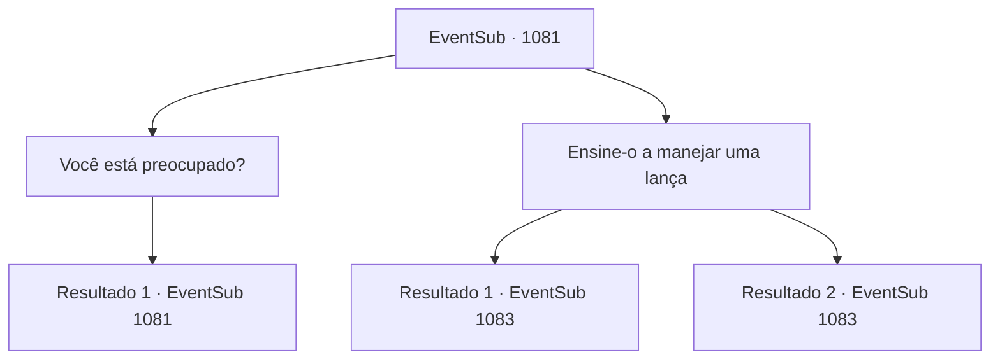

# Eventos secundários · 1081

[Índice da tabela](index.md) · [Índice geral](../index.md)

ID: `pt:EventSub:1081` · Fonte: `EventSub4` · Versão: 1.2.47.

Mapeamento estático dos arquivos; a disponibilidade e a execução dependem do estado da run.

## Texto do evento

*Sem texto no arquivo.*

## Dados de entrada

```json
{
  "id": 1081,
  "grade": 1,
  "subEvent": "",
  "required": ""
}
```

## Mapa das escolhas



## Escolhas e resultados

### Escolha 1

Você está preocupado?

Requisitos e outros campos da escolha:

```json
{
  "required": "5_823_0"
}
```

#### Resultado 1.1

Você pergunta a Irema se ela está preocupada. Ela acena silenciosamente. 

 "Sim... Ed puxou a mim e tem um corpo fraco. Honestamente? Estou mais do que apenas preocupada."

 Ela olha para Edward por um tempo, então acrescenta com um breve suspiro. 

 "Bem, contanto que ele treine dentro dos terrenos do castelo... Acho que está tudo bem."


Continuação registrada: [Evento 1081](1081.md) na mesma tabela.

```json
{
  "required": "",
  "chance": "1",
  "nextEvent": 1081,
  "type": 2,
  "reward": "5_823_1"
}
```

### Escolha 2

Ensine-o a manejar uma lança

Requisitos e outros campos da escolha:

```json
{
  "required": ""
}
```

#### Resultado 2.1

Você pega uma das lanças de madeira e faz algumas demonstrações. Edward observa você atentamente e imita seus movimentos. Ele faz um ótimo trabalho imitando seus movimentos, mas ainda lhe falta força e flexibilidade. Você aponta gentilmente seus pontos fracos. Irema coloca um sorriso satisfeito ao ver vocês dois.  O tempo passa. O brilho alaranjado do pôr do sol surge sobre os jardins. Edward está deitado no chão, sem fôlego. A condessa Irema, que estava esperando sua aula terminar, chama você e Edward. 

 "O jantar está pronto! Por que vocês não se juntam a nós."


Continuação registrada: [Evento 1083](1083.md) na mesma tabela.

```json
{
  "required": "",
  "chance": "1|0_5_1|0_6_1",
  "nextEvent": 1083,
  "type": 0,
  "reward": "5_827_1"
}
```

#### Resultado 2.2

Você pega uma das lanças de madeira e faz algumas demonstrações. Mas seus ensinamentos não conseguem chegar a Edward. Edward fala, um pouco desapontado. 

 "I- isso é mais difícil do que eu pensei...!"

 A condessa Irema, que estava esperando sua aula terminar, chama você e Edward. 

 "O jantar está pronto! Por que vocês não se juntam a nós."


Continuação registrada: [Evento 1083](1083.md) na mesma tabela.

```json
{
  "required": "",
  "chance": "18",
  "nextEvent": 1083,
  "type": 1,
  "reward": ""
}
```

## Referências que chegam a este evento

- [Evento 1080 · escolha 1 · resultado 1](1080.md#escolha-1)
- [Evento 1081 · escolha 1 · resultado 1](1081.md#escolha-1)
