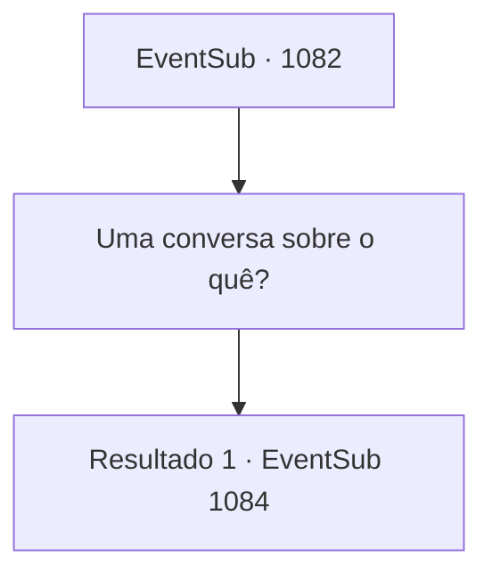

# Eventos secundários · 1082

[Índice da tabela](index.md) · [Índice geral](../index.md)

ID: `pt:EventSub:1082` · Fonte: `EventSub4` · Versão: 1.2.47.

Mapeamento estático dos arquivos; a disponibilidade e a execução dependem do estado da run.

## Texto do evento

*Sem texto no arquivo.*

## Dados de entrada

```json
{
  "id": 1082,
  "grade": 1,
  "subEvent": "",
  "required": ""
}
```

## Mapa das escolhas



## Escolhas e resultados

### Escolha 1

Uma conversa sobre o quê?

Requisitos e outros campos da escolha:

```json
{
  "required": ""
}
```

#### Resultado 1.1

Edward olha para você e dá um olhar assustado. 

 "E- Eu tenho medo das pessoas. O pai disse que eu n- não precisava, mas..."

 Ele diz que está preocupado que as pessoas possam espancá-lo até a morte, assim como Lukas. Isso deve tê-lo traumatizado. 

 "Oh, Ed... Isso nunca vai acontecer. Meu bebê... por que você pensaria isso?"

 A Condessa abraça seu filho com força, acalmando-o. Edward continua com uma voz um pouco mais reservada. 

 "O pai disse que um dia, eu terei que herdar o condado e governar sobre as pessoas. Mas..."

 Você percebe pela maneira como ele fala que ele não está se sentindo confiante e preparado. 

 "E- Eu não acho que tenho o que é preciso! ... E se as pessoas ficarem realmente zangadas e quiserem me matar?"


Continuação registrada: [Evento 1084](1084.md) na mesma tabela.

```json
{
  "required": "",
  "chance": "1",
  "nextEvent": 1084,
  "type": 2,
  "reward": ""
}
```

## Referências que chegam a este evento

- [Evento 1079 · escolha 1 · resultado 2](1079.md#escolha-1)
