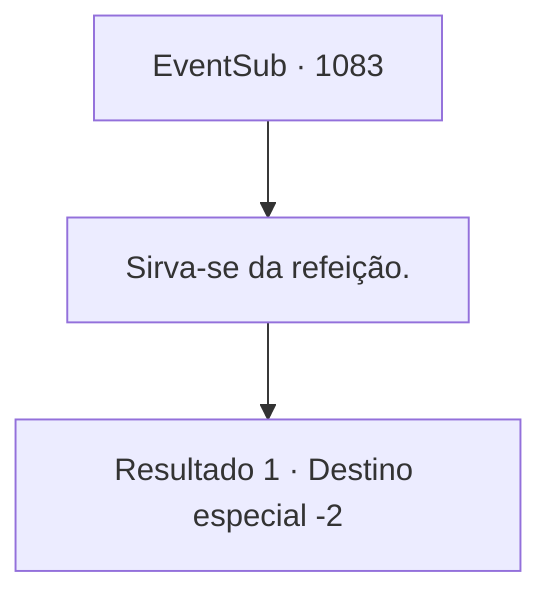

# Eventos secundários · 1083

[Índice da tabela](index.md) · [Índice geral](../index.md)

ID: `pt:EventSub:1083` · Fonte: `EventSub4` · Versão: 1.2.47.

Mapeamento estático dos arquivos; a disponibilidade e a execução dependem do estado da run.

## Texto do evento

*Sem texto no arquivo.*

## Dados de entrada

```json
{
  "id": 1083,
  "grade": 1,
  "subEvent": "",
  "required": ""
}
```

## Mapa das escolhas



## Escolhas e resultados

### Escolha 1

Sirva-se da refeição.

Requisitos e outros campos da escolha:

```json
{
  "required": ""
}
```

#### Resultado 1.1

Você se presenteia com a refeição luxuosa. Em seguida, você descansa merecidamente nos luxuosos aposentos de hóspedes. No dia seguinte, quando está prestes a retornar às suas aventuras, o Conde e sua família saem para se despedir. 

 "Adeus! Mantenha-se saudável!"

 "Até logo!"

 Todos acenam para você em despedida. Você faz o mesmo e deixa os terrenos do castelo.

Continuação registrada: [Destino especial `-2`](../destinos-especiais.md).

```json
{
  "required": "",
  "chance": "1",
  "nextEvent": -2,
  "type": 2,
  "reward": "0_0_1|0_1_1|12_12_-1|14_12_1|14_12_2|5_828_1"
}
```

## Referências que chegam a este evento

- [Evento 1081 · escolha 2 · resultado 1](1081.md#escolha-2)
- [Evento 1081 · escolha 2 · resultado 2](1081.md#escolha-2)
- [Evento 1084 · escolha 1 · resultado 1](1084.md#escolha-1)
- [Evento 1084 · escolha 2 · resultado 1](1084.md#escolha-2)
- [Evento 1084 · escolha 3 · resultado 1](1084.md#escolha-3)
