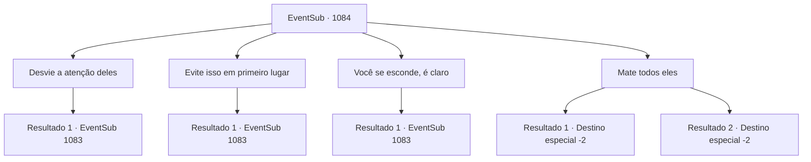

# Eventos secundários · 1084

[Índice da tabela](index.md) · [Índice geral](../index.md)

ID: `pt:EventSub:1084` · Fonte: `EventSub4` · Versão: 1.2.47.

Mapeamento estático dos arquivos; a disponibilidade e a execução dependem do estado da run.

## Texto do evento

*Sem texto no arquivo.*

## Dados de entrada

```json
{
  "id": 1084,
  "grade": 1,
  "subEvent": "",
  "required": ""
}
```

## Mapa das escolhas



## Escolhas e resultados

### Escolha 1

Desvie a atenção deles

Requisitos e outros campos da escolha:

```json
{
  "required": ""
}
```

#### Resultado 1.1

Você o aconselha a dividir as pessoas em vários lados, para que fiquem ocupadas lutando entre si em vez de contra você. Edward acena com a cabeça. 

 "Está bem? Bem, obrigado pelo conselho de qualquer forma!"

 Após sua aula terminar, Irema se aproxima de você. 

 "Você deveria passar por aqui de vez em quando, contar a Edward sobre algumas de suas aventuras. O jantar deve estar pronto agora."

 Você e Edward a seguem até o refeitório.

Continuação registrada: [Evento 1083](1083.md) na mesma tabela.

```json
{
  "required": "",
  "chance": "1",
  "nextEvent": 1083,
  "type": 0,
  "reward": "5_824_1"
}
```

### Escolha 2

Evite isso em primeiro lugar

Requisitos e outros campos da escolha:

```json
{
  "required": ""
}
```

#### Resultado 2.1

Você o aconselha sobre como enfrentar e resolver problemas com sabedoria, sem deixar as pessoas irritadas. 

 "Hmm... É difícil, eu posso ver isso."

 Edward parece um pouco sobrecarregado. Após sua aula terminar, Irema se aproxima de você. 

 "Você deveria passar de vez em quando, contar a Edward algumas de suas aventuras. O jantar deve estar pronto agora."

 Você e Edward a seguem até o refeitório.

Continuação registrada: [Evento 1083](1083.md) na mesma tabela.

```json
{
  "required": "",
  "chance": "1",
  "nextEvent": 1083,
  "type": 0,
  "reward": "5_825_1"
}
```

### Escolha 3

Você se esconde, é claro

Requisitos e outros campos da escolha:

```json
{
  "required": ""
}
```

#### Resultado 3.1

Você o aconselha a evitar problemas sempre que possível. 

 "Hmm... É difícil, eu posso ver isso."

 Edward parece um pouco sobrecarregado. Após sua aula terminar, Irema se aproxima de você. 

 "Você deveria passar de vez em quando, contar a Edward sobre algumas de suas aventuras. O jantar deve estar pronto agora."

 Você e Edward a seguem até o refeitório.

Continuação registrada: [Evento 1083](1083.md) na mesma tabela.

```json
{
  "required": "",
  "chance": "1",
  "nextEvent": 1083,
  "type": 2,
  "reward": "5_826_1"
}
```

### Escolha 4

Mate todos eles

Requisitos e outros campos da escolha:

```json
{
  "required": "2_3_-14"
}
```

#### Resultado 4.1

Você enfatiza a importância do carisma. Você diz a ele que, se executar violentamente e cruelmente todas as pessoas que se opõem a você, ninguém jamais poderá se opor a ele novamente. Irema se aproxima de Edward e cobre seus ouvidos. 

 "Já chega. Ele ainda é uma criança...! Vou fingir que isso não aconteceu."

 Ela então chama os servos. 

 "Por favor, acompanhem {1} para fora dos terrenos do castelo."

 Ela então retorna ao seu quarto com Edward.

Continuação registrada: [Destino especial `-2`](../destinos-especiais.md).

```json
{
  "required": "",
  "chance": "1|0_12_1",
  "nextEvent": -2,
  "type": 0,
  "reward": "12_12_-1|14_12_1|14_12_2"
}
```

#### Resultado 4.2

Você enfatiza a importância do carisma. Você diz a ele que, se executar violentamente e cruelmente todas as pessoas que se opõem a você, ninguém jamais poderá se opor a ele novamente. Irema se aproxima de Edward e cobre seus ouvidos. 

 "Já chega. Ele ainda é uma criança...! Vou fingir que isso não aconteceu."

 Ela então chama os servos. 

 "Por favor, acompanhem {1} para fora dos terrenos do castelo."

 Ela então retorna ao seu quarto com Edward. Você segue o servo para fora dos terrenos do castelo.

Continuação registrada: [Destino especial `-2`](../destinos-especiais.md).

```json
{
  "required": "",
  "chance": "25",
  "nextEvent": -2,
  "type": 1,
  "reward": "12_12_-1|14_12_1|14_12_2"
}
```

## Referências que chegam a este evento

- [Evento 1082 · escolha 1 · resultado 1](1082.md#escolha-1)
