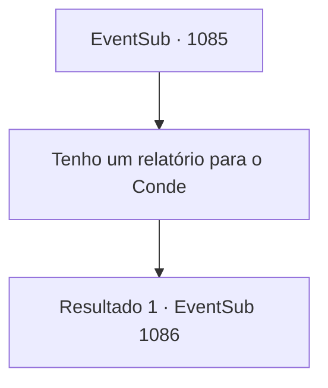

# Eventos secundários · 1085

[Índice da tabela](index.md) · [Índice geral](../index.md)

ID: `pt:EventSub:1085` · Fonte: `EventSub4` · Versão: 1.2.47.

Mapeamento estático dos arquivos; a disponibilidade e a execução dependem do estado da run.

## Texto do evento

|drawing_Rouent| Mais uma vez você se dirige à cidade capital do Condado de Ronan, e imediatamente ao castelo do Conde. Ao se aproximar dos portões do castelo, o guarda o nota e fala. 

 "Ah. Você deve ser o aventureiro da última vez com Sir Lupin. Qual é o seu negócio hoje?"


## Dados de entrada

```json
{
  "id": 1085,
  "grade": 2,
  "subEvent": "",
  "required": "12_12_11"
}
```

## Mapa das escolhas



## Escolhas e resultados

### Escolha 1

Tenho um relatório para o Conde

Requisitos e outros campos da escolha:

```json
{
  "required": ""
}
```

#### Resultado 1.1

Você é guiado pelo soldado até a câmara de audiência. A pesada porta se abre. Você entra no salão espaçoso. Paredes de pedra fria cobrem a área, com um lustre de ferro pendurado no teto, emitindo uma luz fraca. No final do salão há uma fundação elevada, no topo da qual estão três cadeiras luxuosas. Sentado na cadeira do centro está ninguém menos que o próprio Conde Ronan. Nas duas cadeiras ao redor do Conde devem estar suas esposas. Uma parece ter a mesma idade do Conde, com cabelos branco-prateados e olhos vermelhos como carmim que lembram Edward. A outra, com cabelos loiros e encaracolados, está, a julgar pelo tamanho de sua barriga, grávida. Ela parece muito mais jovem que o Conde. O olhar do Conde pousa em você. 

 "Então - que negócios você tem comigo?"


Continuação registrada: [Evento 1086](1086.md) na mesma tabela.

```json
{
  "required": "",
  "chance": "1",
  "nextEvent": 1086,
  "type": 2,
  "reward": ""
}
```

## Referências que chegam a este evento

Nenhum `nextEvent` positivo da mesma tabela aponta para este nó. Isso não prova que seja inacessível: sorteio e estado de história podem selecioná-lo.

