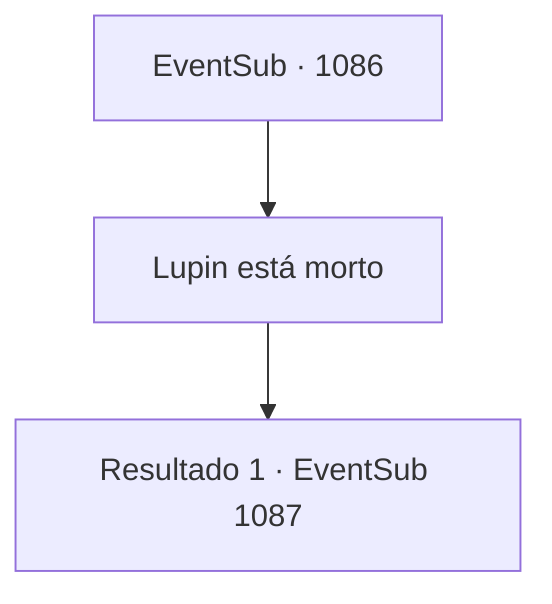

# Eventos secundários · 1086

[Índice da tabela](index.md) · [Índice geral](../index.md)

ID: `pt:EventSub:1086` · Fonte: `EventSub4` · Versão: 1.2.47.

Mapeamento estático dos arquivos; a disponibilidade e a execução dependem do estado da run.

## Texto do evento

*Sem texto no arquivo.*

## Dados de entrada

```json
{
  "id": 1086,
  "grade": 1,
  "subEvent": "",
  "required": ""
}
```

## Mapa das escolhas



## Escolhas e resultados

### Escolha 1

Lupin está morto

Requisitos e outros campos da escolha:

```json
{
  "required": ""
}
```

#### Resultado 1.1

Você conta a ele tudo o que aconteceu nas Catacumbas. Como Lukas sequestrou Edward e como Lupin morreu. As sobrancelhas do Conde se contraem enquanto ele ouve seu relato. Seu rosto se contorce de raiva. 

 "O- o quê...?! Lukas, aquele desgraçado! Até mesmo Lupin...!"

 Você nota as veias em sua testa saltando. Furioso, o Conde se levanta de seu assento, cobre a cabeça e depois se senta novamente. 

 "Querido, querido... acalme-se."

 Só depois que a Condessa o acalma, Ronan continua após um suspiro. Seus olhos vermelhos se dirigem a você em seguida. 

 "*suspiro*... Bem, obrigado por nos informar."


Continuação registrada: [Evento 1087](1087.md) na mesma tabela.

```json
{
  "required": "",
  "chance": "1",
  "nextEvent": 1087,
  "type": 2,
  "reward": ""
}
```

## Referências que chegam a este evento

- [Evento 1085 · escolha 1 · resultado 1](1085.md#escolha-1)
