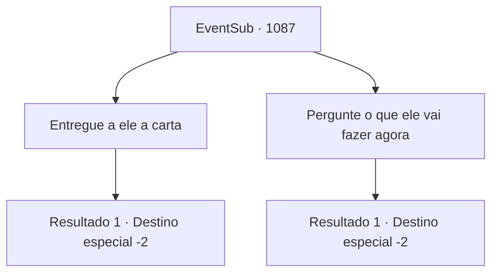

# Eventos secundários · 1087

[Índice da tabela](index.md) · [Índice geral](../index.md)

ID: `pt:EventSub:1087` · Fonte: `EventSub4` · Versão: 1.2.47.

Mapeamento estático dos arquivos; a disponibilidade e a execução dependem do estado da run.

## Texto do evento

*Sem texto no arquivo.*

## Dados de entrada

```json
{
  "id": 1087,
  "grade": 1,
  "subEvent": "",
  "required": ""
}
```

## Mapa das escolhas



## Escolhas e resultados

### Escolha 1

Entregue a ele a carta

Requisitos e outros campos da escolha:

```json
{
  "required": "8_365_1"
}
```

#### Resultado 1.1

Você tira a carta de Hazel. O Conde responde com um olhar confuso. Quanto a Hazel, ela já está ficando pálida. 

 "O que é isso?"

 O Conde Ronan leva um minuto para ler a carta. Seu rosto fica vermelho de raiva. Até suas mãos estão tremendo. 

 "... SOLDADOS! PRENDAM HAZEL, IMEDIATAMENTE!"

 Todos na sala ficam surpresos ao ouvir isso. Os soldados hesitam a princípio em sequer tocar no corpo da segunda esposa. Mas Ronan insiste, até desembainhando sua própria espada. 

 "EU GAGUEJEI?! PRENDAM ESSA BRUXA, AGORA MESMO!"

 Hazel implora inocência, seus olhos arregalados de medo, mas Ronan parece não ter intenção de ouvi-la. Infelizmente, Hazel é arrastada para longe. O Conde solta um longo suspiro e se senta novamente em seu assento. 

 "*suspiro*... O que é tudo isso...?"

 Ele enxuga o suor do rosto e tenta se acalmar. O Conde se recompõe, se vira para você e continua. 

 "...Obrigado. Você conseguiu extirpar uma infecção de nossa Casa."

 Ele lentamente se levanta novamente. 

 "Agora preciso ir aos Catacumbas eu mesmo."

 Então, ele faz um gesto com as mãos para um de seus servos. 

 "Recompense {1} com 200 moedas de ouro. Um símbolo de apreciação, por todo o seu trabalho árduo."

 O Conde deixa a câmara de audiência com sua esposa. Você pega o ouro do servo.

Continuação registrada: [Destino especial `-2`](../destinos-especiais.md).

```json
{
  "required": "",
  "chance": "1",
  "nextEvent": -2,
  "type": 2,
  "reward": "12_12_-1|14_12_3|0_4_200|14_12_6|4_365_1"
}
```

### Escolha 2

Pergunte o que ele vai fazer agora

Requisitos e outros campos da escolha:

```json
{
  "required": "10_365_1"
}
```

#### Resultado 2.1

Ele lentamente se levanta. 

 "Agora preciso ir às Catacumbas eu mesmo. Para trazer Edward de volta."

 Então, ele faz um gesto com as mãos para um de seus servos. 

 "Recompense {1} com 100 moedas de ouro. Um sinal de apreço, por todo o seu trabalho árduo."

 O Conde deixa a sala de audiências com sua esposa. Você pega silenciosamente o ouro do servo. O servo o acompanha para fora dos terrenos do castelo, então se inclina educadamente. 

 "Adeus."

 E com isso, o portão do castelo se fecha.

Continuação registrada: [Destino especial `-2`](../destinos-especiais.md).

```json
{
  "required": "",
  "chance": "1",
  "nextEvent": -2,
  "type": 2,
  "reward": "12_12_-1|0_4_100|14_12_12"
}
```

## Referências que chegam a este evento

- [Evento 1086 · escolha 1 · resultado 1](1086.md#escolha-1)
