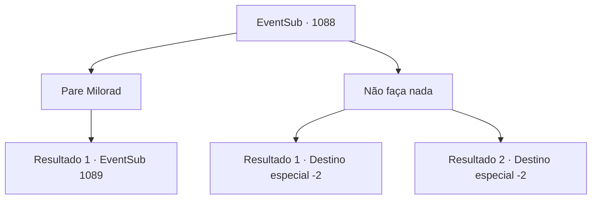

# Eventos secundários · 1088

[Índice da tabela](index.md) · [Índice geral](../index.md)

ID: `pt:EventSub:1088` · Fonte: `EventSub4` · Versão: 1.2.47.

Mapeamento estático dos arquivos; a disponibilidade e a execução dependem do estado da run.

## Texto do evento

*Sem texto no arquivo.*

## Dados de entrada

```json
{
  "id": 1088,
  "grade": 1,
  "subEvent": "",
  "required": ""
}
```

## Mapa das escolhas



## Escolhas e resultados

### Escolha 1

Pare Milorad

Requisitos e outros campos da escolha:

```json
{
  "required": ""
}
```

#### Resultado 1.1

Você para Milorad, dizendo a ele que Lukas precisa passar por um julgamento justo. 

 "Um julgamento justo?"

 Milorad para, olha para você sem expressão por um momento, então balança sua espada longa em sua direção.

Continuação registrada: [Evento 1089](1089.md) na mesma tabela.

```json
{
  "required": "",
  "chance": "1",
  "nextEvent": 1089,
  "type": 2,
  "reward": "6_0_185",
  "place": 7
}
```

### Escolha 2

Não faça nada

Requisitos e outros campos da escolha:

```json
{
  "required": ""
}
```

#### Resultado 2.1

Milorad fala friamente. 

 "Vejo sua convicção."

 Ele então arrasta Lukas para fora das Catacumbas, depois para uma árvore próxima. Ele procede a enforcar Lukas nela. 

 "*tosse*... Ack..! Ugh...!"

 A luta de Lukas não dura muito. Depois que seu corpo finalmente fica imóvel, Milorad se vira para falar com você. 

 "Agradeço pela sua cooperação."

 Em seguida, ele vasculha as coisas de Lukas, entrega a você o que encontrou dentro, e vai embora. Você pega o saque e vai até Lupin, para notificá-lo da morte de Lukas.

Continuação registrada: [Destino especial `-2`](../destinos-especiais.md).

```json
{
  "required": "18_822_1",
  "chance": "1",
  "nextEvent": -2,
  "type": 2,
  "reward": "12_12_9|0_4_100|3_364_1"
}
```

#### Resultado 2.2

Milorad fala friamente. 

 "Vejo sua convicção."

 Ele então arrasta Lukas para fora das Catacumbas, depois até uma árvore próxima. Ele procede a enforcar Lukas nela. 

 "*tosse*... Ack..! Ugh...!"

 A luta de Lukas não dura muito. Depois que seu corpo finalmente fica imóvel, Milorad se vira para falar com você. 

 "Agradeço pela sua cooperação. Pegue isto. Deve lhe servir bem."

 Ele lhe entrega sua grande espada e então vai embora.

Continuação registrada: [Destino especial `-2`](../destinos-especiais.md).

```json
{
  "required": "5_822_1",
  "chance": "1",
  "nextEvent": -2,
  "type": 2,
  "reward": "3_369_1|12_12_-1|14_12_2"
}
```

## Referências que chegam a este evento

- [Evento 1068 · escolha 1 · resultado 1](1068.md#escolha-1)
- [Evento 1068 · escolha 1 · resultado 2](1068.md#escolha-1)
- [Evento 1069 · escolha 1 · resultado 1](1069.md#escolha-1)
- [Evento 1069 · escolha 1 · resultado 2](1069.md#escolha-1)
