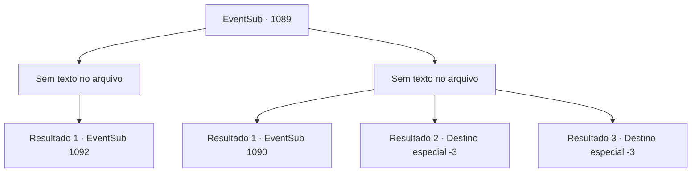

# Eventos secundários · 1089

[Índice da tabela](index.md) · [Índice geral](../index.md)

ID: `pt:EventSub:1089` · Fonte: `EventSub4` · Versão: 1.2.47.

Mapeamento estático dos arquivos; a disponibilidade e a execução dependem do estado da run.

## Texto do evento

*Sem texto no arquivo.*

## Dados de entrada

```json
{
  "id": 1089,
  "grade": 1,
  "subEvent": "",
  "required": ""
}
```

## Mapa das escolhas



## Escolhas e resultados

### Escolha 1

*Sem texto no arquivo; o papel dessa opção depende da interface do jogo.*

Requisitos e outros campos da escolha:

```json
{
  "required": ""
}
```

#### Resultado 1.1

Você subjuga Milorad e o amarra com sua corda. Lukas observa e ri maniacamente. 

 "Ha... Phahaha... Você me traiu, e agora vai morrer comigo aqui."

 Milorad olha para Lukas com os olhos. Lukas evita seu olhar. Então, Milorad se vira para você e implora desesperadamente uma última vez. 

 "Quando o julgamento começar... Hazel e o bebê não vão sobreviver. Por favor... mostre misericórdia, uma última vez. Este será meu pedido final."

 Lukas ouve isso, então grita. 

 "O- o que você quer dizer com eles não vão sobreviver?! Eles seriam exilados, talvez, duvido que os executem!"

 Mas Milorad mantém a boca fechada.

Continuação registrada: [Evento 1092](1092.md) na mesma tabela.

```json
{
  "required": "",
  "chance": "1",
  "nextEvent": 1092,
  "type": 2,
  "reward": ""
}
```

### Escolha 2

*Sem texto no arquivo; o papel dessa opção depende da interface do jogo.*

Requisitos e outros campos da escolha:

```json
{
  "required": ""
}
```

#### Resultado 2.1

Milorad derrota você e também te amarra. Lukas assiste e ri maniacamente, como se tivesse perdido a esperança. 

 "Phahaha... Agora você vai morrer aqui comigo."

 Infelizmente, você e Lukas são pendurados na árvore. Milorad deixa você e Lukas pendurados. À medida que respirar se torna cada vez mais difícil e sua consciência lentamente começa a se desvanecer, o galho da árvore quebra, e você cai no chão. Você bate a cabeça com força em uma pedra próxima e perde a consciência.

Continuação registrada: [Evento 1090](1090.md) na mesma tabela.

```json
{
  "required": "1_0_2|1_1_2",
  "chance": "1",
  "nextEvent": 1090,
  "type": 2,
  "reward": "0_0_-1|0_1_-1|12_12_-1|14_12_2"
}
```

#### Resultado 2.2

Milorad derrota você e também o amarra. Lukas assiste e ri maniacamente, como se tivesse perdido a esperança. 

 "Phahaha... Agora você vai morrer aqui comigo."

 Infelizmente, você e Lukas são pendurados na árvore. Milorad deixa você e Lukas pendurados. Respirar se torna cada vez mais difícil, e sua consciência lentamente começa a se desvanecer.

Continuação registrada: [Destino especial `-3`](../destinos-especiais.md).

```json
{
  "required": "2_0_2",
  "chance": "1",
  "nextEvent": -3,
  "type": 2,
  "reward": "0_0_-1|0_1_-1"
}
```

#### Resultado 2.3

Milorad derrota você e também o amarra. Lukas assiste e ri maniacamente, como se tivesse perdido a esperança. 

 "Phahaha... Agora você vai morrer aqui comigo."

 Infelizmente, você e Lukas são pendurados na árvore. Milorad deixa você e Lukas pendurados. Respirar se torna cada vez mais difícil, e sua consciência lentamente começa a se desvanecer.

Continuação registrada: [Destino especial `-3`](../destinos-especiais.md).

```json
{
  "required": "2_1_2",
  "chance": "1",
  "nextEvent": -3,
  "type": 2,
  "reward": "0_0_-1|0_1_-1"
}
```

## Referências que chegam a este evento

- [Evento 1088 · escolha 1 · resultado 1](1088.md#escolha-1)
