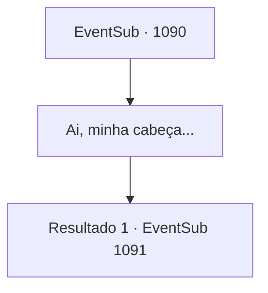

# Eventos secundários · 1090

[Índice da tabela](index.md) · [Índice geral](../index.md)

ID: `pt:EventSub:1090` · Fonte: `EventSub4` · Versão: 1.2.47.

Mapeamento estático dos arquivos; a disponibilidade e a execução dependem do estado da run.

## Texto do evento

*Sem texto no arquivo.*

## Dados de entrada

```json
{
  "id": 1090,
  "grade": 1,
  "subEvent": "",
  "required": ""
}
```

## Mapa das escolhas



## Escolhas e resultados

### Escolha 1

Ai, minha cabeça...

Requisitos e outros campos da escolha:

```json
{
  "required": ""
}
```

#### Resultado 1.1

Você abre os olhos por causa da dor intensa na sua cabeça. Você se encontra sob um teto velho e desgastado. Você se senta e olha ao redor. Então, você nota um velho em uma poltrona próxima. Por um momento, você pensa que ele está morto. Seus olhos só se abrem depois que você se aproxima dele. 

 "Ah. Você acordou. Já se passaram quatro dias...?"

 Ele se levanta lentamente da poltrona. 

 "Sou o coveiro que trabalha nas Catacumbas. Você estava sangrando no chão, então eu te trouxe de volta. O outro que estava pendurado na árvore - era seu amigo? Ele já se foi, receio."


Continuação registrada: [Evento 1091](1091.md) na mesma tabela.

```json
{
  "required": "",
  "chance": "1",
  "nextEvent": 1091,
  "type": 2,
  "reward": ""
}
```

## Referências que chegam a este evento

- [Evento 1089 · escolha 2 · resultado 1](1089.md#escolha-2)
