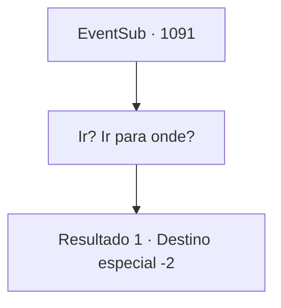

# Eventos secundários · 1091

[Índice da tabela](index.md) · [Índice geral](../index.md)

ID: `pt:EventSub:1091` · Fonte: `EventSub4` · Versão: 1.2.47.

Mapeamento estático dos arquivos; a disponibilidade e a execução dependem do estado da run.

## Texto do evento

*Sem texto no arquivo.*

## Dados de entrada

```json
{
  "id": 1091,
  "grade": 1,
  "subEvent": "",
  "required": ""
}
```

## Mapa das escolhas



## Escolhas e resultados

### Escolha 1

Ir? Ir para onde?

Requisitos e outros campos da escolha:

```json
{
  "required": ""
}
```

#### Resultado 1.1

O coveiro responde secamente. 

 "Bem, onde você acha que ele foi? Para a vida após a morte, é claro."

 Ele te encara por um momento antes de continuar, em um tom sério. 

 "...Você ainda é jovem. Não desista da vida tão facilmente. Todo mundo comete erros, todo mundo tem aqueles dias."

 Ele acrescenta que, uma vez que você continue vivendo e olhe para trás mais tarde, o que parecia o fim do mundo se revelará ser nada. O velho não tem ideia do que realmente aconteceu, você percebe. Você o agradece de qualquer forma pelo conselho e então sai da casa dele. Enquanto você atravessa a cidade, ouve os moradores fofocando. 

 "Você ouviu? O bispo Lukas tirou a própria vida. O caso dele com a Sra. Hazel foi exposto, ou algo assim."

 Outro pergunta de volta com uma voz animada. 

 "Ah, a Hazel será executada, então?"

 "Não. Ouvi dizer que ela foi exilada do condado."

 Você discretamente escuta a conversa deles e depois sai da área.

Continuação registrada: [Destino especial `-2`](../destinos-especiais.md).

```json
{
  "required": "",
  "chance": "1",
  "nextEvent": -2,
  "type": 2,
  "reward": ""
}
```

## Referências que chegam a este evento

- [Evento 1090 · escolha 1 · resultado 1](1090.md#escolha-1)
