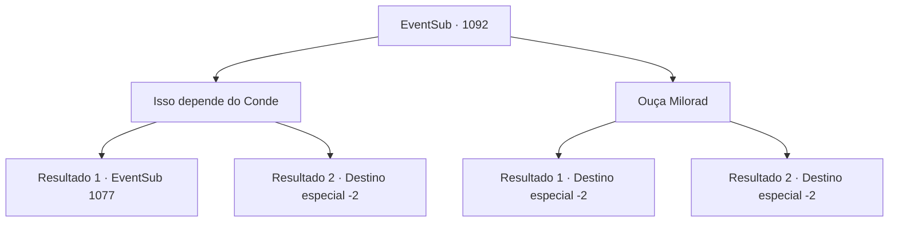

# Eventos secundários · 1092

[Índice da tabela](index.md) · [Índice geral](../index.md)

ID: `pt:EventSub:1092` · Fonte: `EventSub4` · Versão: 1.2.47.

Mapeamento estático dos arquivos; a disponibilidade e a execução dependem do estado da run.

## Texto do evento

*Sem texto no arquivo.*

## Dados de entrada

```json
{
  "id": 1092,
  "grade": 1,
  "subEvent": "",
  "required": ""
}
```

## Mapa das escolhas



## Escolhas e resultados

### Escolha 1

Isso depende do Conde

Requisitos e outros campos da escolha:

```json
{
  "required": ""
}
```

#### Resultado 1.1

Você deixa claro que não vai ouvi-los. Então, você os leva para uma cidade próxima, usa o ouro de Lukas para alugar uma carruagem e segue para o Conde Ronan. A carruagem parece uma caverna gelada feita de gelo. Ninguém se atreve a falar. 

 Alguns dias depois, você entra na sala de audiência do Conde Ronan com Milorad e Lukas. O Conde, suas duas esposas e até Lupin ficam surpresos ao ver isso. 

 "V- você capturou, Lukas, eu vejo! E quem é esse homem ao lado dele?"

 Em resposta à pergunta do Conde, você conta tudo o que aconteceu nas Catacumbas. Você os apresenta a Milorad, irmão mais velho de Hazel, e revela que ele tentou incriminar Lukas por tudo, para salvar Hazel. 

 "Isso é tudo verdade, Milorad?"

 Milorad acena em reconhecimento. 

 "Tudo o que desejo fazer... é salvar Hazel e seu bebê. Por favor, mostre misericórdia. Eu imploro."

 Lupin, no entanto, insiste que tanto Hazel quanto Milorad sejam punidos. A Condessa de cabelos brancos senta-se ao lado do Conde, observando-o com olhos piedosos. A testa de Ronan se enruga. 

 "Depois. Vou decidir depois."

 O Conde ordena que seus soldados prendam Lukas e Milorad. Então, ele se volta para você. 

 "Ouvi de Lupin que você foi responsável por encontrar e salvar Edward. Obrigado, do fundo do meu coração, por salvar meu filho. E graças a você, também consegui descobrir o esquema de Hazel e Lukas! Ainda não sei como posso te agradecer o suficiente."

 Ele pede que você espere, depois volta com uma lança luxuosa. 

 "Obrigado mais uma vez, {1}. Minha Casa não é exatamente conhecida por suas riquezas, mas temos raízes que remontam a uma linhagem de um grande guerreiro. História orgulhosa, eu diria."

 Ele continua, mostrando a você a relíquia de família. 

 "Aqui - uma lança ancestral, passada por gerações. Ah, e se você tiver tempo, fique. Tenho certeza de que você poderia usar uma pausa de suas viagens e aventuras. Edward ficaria feliz em vê-lo novamente também."


Continuação registrada: [Evento 1077](1077.md) na mesma tabela.

```json
{
  "required": "18_822_1",
  "chance": "1",
  "nextEvent": 1077,
  "type": 2,
  "reward": "3_367_1|12_12_-1|14_12_1|14_12_3"
}
```

#### Resultado 1.2

Você deixa claro que não vai ouvi-los. Então, você os leva para uma cidade próxima, usa o ouro de Lukas para alugar uma carruagem e segue para o Conde Ronan. A carruagem parece uma caverna gelada feita de gelo. Ninguém se atreve a falar. 

 Alguns dias depois, você entra na sala de audiências do Conde Ronan com Milorad e Lukas. O Conde, suas duas esposas e até Lupin ficam surpresos ao ver isso. 

 "V- você capturou, Lukas, eu vejo! E quem é esse homem ao lado dele?"

 Em resposta à pergunta do Conde, você conta tudo o que aconteceu nas Catacumbas. Você os apresenta a Milorad, irmão mais velho de Hazel, e revela que ele tentou incriminar Lukas por tudo, para salvar Hazel. 

 "Isso é tudo verdade, Milorad?"

 Milorad acena em reconhecimento. 

 "Tudo o que desejo fazer... é salvar Hazel e seu bebê. Por favor, mostre misericórdia. Eu imploro."

 Lupin, no entanto, insiste que tanto Hazel quanto Milorad sejam punidos. A Condessa de cabelos brancos senta-se ao lado do Conde, observando-o com olhos piedosos. A testa de Ronan se enruga. 

 "Depois. Decidirei depois."

 O Conde ordena que seus soldados prendam Lukas e Milorad. Então, ele se volta para você. 

 "Deve ter sido uma jornada cansativa, capturar Lukas e trazê-lo até aqui. Obrigado. Por que você não descansa esta noite? Tenho certeza de que você poderia usar uma pausa de suas viagens e aventuras."

 Você passa a noite no castelo do Conde. Você dorme tranquilamente no luxuoso quarto de hóspedes. No dia seguinte, quando você está prestes a retornar às suas aventuras, o Conde e sua família saem para se despedir. 

 "Adeus! Mantenha-se saudável!"

 Todos acenam para você em despedida. Você faz o mesmo e deixa os terrenos do castelo.

Continuação registrada: [Destino especial `-2`](../destinos-especiais.md).

```json
{
  "required": "5_822_1",
  "chance": "1",
  "nextEvent": -2,
  "type": 2,
  "reward": "12_12_-1|14_12_3|14_12_1"
}
```

### Escolha 2

Ouça Milorad

Requisitos e outros campos da escolha:

```json
{
  "required": ""
}
```

#### Resultado 2.1

Você libertou Milorad. Ele se curva para mostrar gratidão. 

 "Obrigado, avent- quero dizer, ó misericordioso."

 Ele então arrasta Lukas para uma árvore próxima. Ele procede a enforcar Lukas nela. 

 "*tosse*... Ack..! Ugh...!"

 A luta de Lukas não dura muito. Depois que seu corpo finalmente fica imóvel, Milorad se vira para falar com você. 

 "Agradeço mais uma vez por me mostrar misericórdia."

 Em seguida, ele vasculha as coisas de Lukas, entrega a você o que encontrou e vai embora. Você pega o saque e vai até Lupin, para notificá-lo da morte de Lukas.

Continuação registrada: [Destino especial `-2`](../destinos-especiais.md).

```json
{
  "required": "18_822_1",
  "chance": "1",
  "nextEvent": -2,
  "type": 2,
  "reward": "12_12_9|0_4_100|3_364_1"
}
```

#### Resultado 2.2

Você libertou Milorad. Ele se inclina para mostrar gratidão. 

 "Obrigado, avent- quero dizer, ó misericordioso."

 Ele então arrasta Lukas para uma árvore próxima. Ele procede a enforcar Lukas nela. 

 "*tosse*... Ack..! Ugh...!"

 A luta de Lukas não dura muito. Depois que seu corpo finalmente fica imóvel, Milorad se vira para falar com você. 

 "Agradeço mais uma vez por me mostrar misericórdia. Por favor, aceite isto - deve ser útil para sua jornada à frente."

 Ele lhe entrega sua enorme espada grande e depois vai embora.

Continuação registrada: [Destino especial `-2`](../destinos-especiais.md).

```json
{
  "required": "5_822_1",
  "chance": "1",
  "nextEvent": -2,
  "type": 2,
  "reward": "3_369_1|12_12_-1|14_12_2"
}
```

## Referências que chegam a este evento

- [Evento 1089 · escolha 1 · resultado 1](1089.md#escolha-1)
