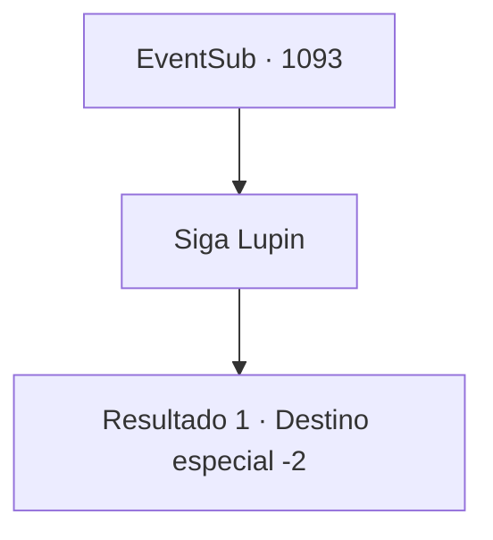

# Eventos secundários · 1093

[Índice da tabela](index.md) · [Índice geral](../index.md)

ID: `pt:EventSub:1093` · Fonte: `EventSub4` · Versão: 1.2.47.

Mapeamento estático dos arquivos; a disponibilidade e a execução dependem do estado da run.

## Texto do evento

Você acaba de cruzar 'Rouent', a capital do Condado de Ronan. Lá, você encontra Lupin, o nobre cavaleiro. Ele levanta as mãos para cumprimentá-lo. 

 "Oh! Eu estava pensando em lhe escrever uma carta. Isso me poupará o trabalho. Vamos conversar."


## Dados de entrada

```json
{
  "id": 1093,
  "grade": 2,
  "subEvent": "",
  "required": "12_12_12"
}
```

## Mapa das escolhas



## Escolhas e resultados

### Escolha 1

Siga Lupin

Requisitos e outros campos da escolha:

```json
{
  "required": ""
}
```

#### Resultado 1.1

Você segue Lupin até uma taverna tranquila. Lupin pede uma cerveja para si mesmo e concorda em comprar um copo para você também. Ele toma um gole de sua caneca e então fala. 

 "... Aquele vilão Lukas está oficialmente em negociações com meu senhor. Parece que ele está disposto a libertar o Jovem Mestre Edward, em troca de Hazel."

 Ele acrescenta que, se estivesse ao seu alcance, mataria Lukas num instante e traria Edward de volta. Ele só se culpa por não conseguir cumprir os desejos de seu senhor. 

 "Bem... É a vida, eu acho. A única coisa que posso fazer agora é rezar para que a negociação vá bem. Venha, beba comigo."

 Você brinda com Lupin, bebendo a cerveja. Ele esvazia seu copo e então tira algo do bolso. 

 "Pegue isto. Você merece um pagamento, por tudo que fez por nós."

 É uma espada curta bem trabalhada. Você aceita a arma com prazer e se despede dele.

Continuação registrada: [Destino especial `-2`](../destinos-especiais.md).

```json
{
  "required": "",
  "chance": "1",
  "nextEvent": -2,
  "type": 2,
  "reward": "12_12_-1|14_12_1|14_12_6|3_75_1"
}
```

## Referências que chegam a este evento

Nenhum `nextEvent` positivo da mesma tabela aponta para este nó. Isso não prova que seja inacessível: sorteio e estado de história podem selecioná-lo.

