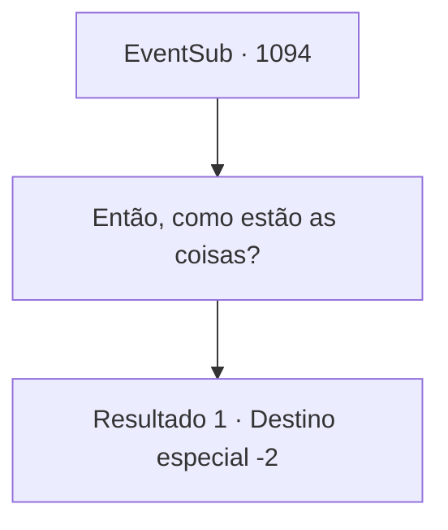

# Eventos secundários · 1094

[Índice da tabela](index.md) · [Índice geral](../index.md)

ID: `pt:EventSub:1094` · Fonte: `EventSub4` · Versão: 1.2.47.

Mapeamento estático dos arquivos; a disponibilidade e a execução dependem do estado da run.

## Texto do evento

*Sem texto no arquivo.*

## Dados de entrada

```json
{
  "id": 1094,
  "grade": 2,
  "subEvent": "",
  "required": ""
}
```

## Mapa das escolhas



## Escolhas e resultados

### Escolha 1

Então, como estão as coisas?

Requisitos e outros campos da escolha:

```json
{
  "required": ""
}
```

#### Resultado 1.1

A condessa Irema responde com um sorriso caloroso. 

 "Na verdade, não poderia estar melhor. E é tudo graças a você, {1}. Edward também tem um novo amigo."

 Ela acrescenta que a presença de Erina está desempenhando um grande papel na recuperação de Edward, tanto física quanto mentalmente. 

 "Ela nos visita uma vez por mês de diligência, mas estou pensando em mudar a família de Erina para algum lugar perto do castelo. Parece que Edward realmente gostou de Erina."

 Você conversa um pouco mais com a condessa. Você dorme tranquilamente no luxuoso quarto de hóspedes. No dia seguinte, quando você está prestes a retornar às suas aventuras, o conde e sua família vêm se despedir. 

 "Adeus! Mantenha-se saudável!"

 Todos acenam para você em despedida. Você faz o mesmo e deixa os terrenos do castelo.

Continuação registrada: [Destino especial `-2`](../destinos-especiais.md).

```json
{
  "required": "",
  "chance": "1",
  "nextEvent": -2,
  "type": 2,
  "reward": "5_828_9|0_4_50|3_36_1|3_37_1|12_12_-1|14_12_8|14_12_2"
}
```

## Referências que chegam a este evento

- [Evento 1077 · escolha 1 · resultado 2](1077.md#escolha-1)
