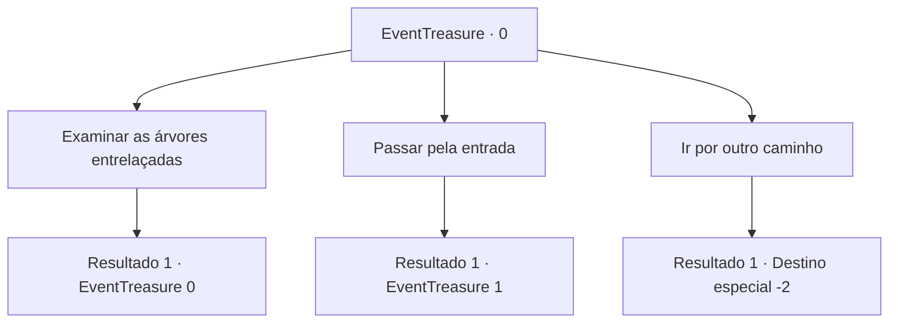

# Eventos de tesouro · 0

[Índice da tabela](index.md) · [Índice geral](../index.md)

ID: `pt:EventTreasure:0` · Fonte: `EventTreasure4` · Versão: 1.2.47.

Mapeamento estático dos arquivos; a disponibilidade e a execução dependem do estado da run.

## Texto do evento

|drawing_jungle|Você anda pela floresta, densa com mato e árvores. Então, você encontra várias árvores passando uma sensação misteriosa. Elas estão entrelaçadas, formando um arco; parece uma entrada para outro mundo.

## Dados de entrada

```json
{
  "id": 0,
  "grade": 1,
  "place": "",
  "required": "5_40_0|1_2_200"
}
```

## Mapa das escolhas



## Escolhas e resultados

### Escolha 1

Examinar as árvores entrelaçadas

Requisitos e outros campos da escolha:

```json
{
  "required": "5_40_0"
}
```

#### Resultado 1.1

Algo está escrito nas árvores entrelaçadas. 
'14 de Junho do final do século. Nono de nove. Escolha algo relacionado à isso.'
 Parece estar relacionado ao enigma escondido na frente.

Continuação registrada: [Evento 0](0000.md) na mesma tabela.

```json
{
  "required": "",
  "chance": "1",
  "nextEvent": 0,
  "type": 2,
  "reward": "5_40_1"
}
```

### Escolha 2

Passar pela entrada

Requisitos e outros campos da escolha:

```json
{
  "required": ""
}
```

#### Resultado 2.1

Você se sente misteriosamente atraído por isso e entra na 'entrada'. Após caminhar pelo caminho por cerca de uma hora, três estradas surgem diante dos seus olhos. Na entrada da esquerda, você encontra mudas de árvores. Na entrada do meio, você encontra vinhas exuberantes. Na entrada da direita, você encontra árvores secas.

Continuação registrada: [Evento 1](0001.md) na mesma tabela.

```json
{
  "required": "",
  "chance": "1",
  "nextEvent": 1,
  "type": 2,
  "reward": "5_40_2"
}
```

### Escolha 3

Ir por outro caminho

Requisitos e outros campos da escolha:

```json
{
  "required": ""
}
```

#### Resultado 3.1

Você ignora a entrada mística e vai por um caminho diferente.

Continuação registrada: [Destino especial `-2`](../destinos-especiais.md).

```json
{
  "required": "",
  "chance": "1",
  "nextEvent": -2,
  "type": 2,
  "reward": "5_40_9"
}
```

## Referências que chegam a este evento

- [Evento 0 · escolha 1 · resultado 1](0000.md#escolha-1)
