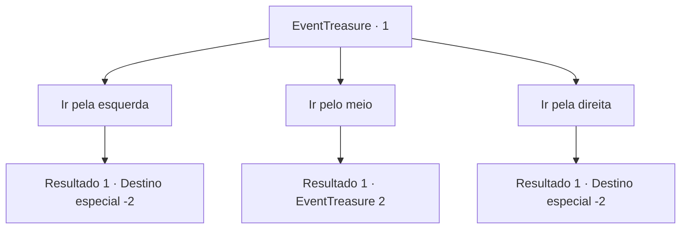

# Eventos de tesouro · 1

[Índice da tabela](index.md) · [Índice geral](../index.md)

ID: `pt:EventTreasure:1` · Fonte: `EventTreasure4` · Versão: 1.2.47.

Mapeamento estático dos arquivos; a disponibilidade e a execução dependem do estado da run.

## Texto do evento

*Sem texto no arquivo.*

## Dados de entrada

```json
{
  "id": 1,
  "grade": 1,
  "place": "",
  "required": ""
}
```

## Mapa das escolhas



## Escolhas e resultados

### Escolha 1

Ir pela esquerda

Requisitos e outros campos da escolha:

```json
{
  "required": ""
}
```

#### Resultado 1.1

Você passa pelas mudas e lentamente segue o caminho da esquerda. Você teme que algo pule em você, mas nada acontece. Passo a passo, você atravessa a floresta e percebe que saiu pelo outro lado.

Continuação registrada: [Destino especial `-2`](../destinos-especiais.md).

```json
{
  "required": "",
  "chance": "1",
  "nextEvent": -2,
  "type": 2,
  "reward": ""
}
```

### Escolha 2

Ir pelo meio

Requisitos e outros campos da escolha:

```json
{
  "required": ""
}
```

#### Resultado 2.1

Você passa pelas videiras exuberantes e lentamente segue o caminho. Você teme que algo pule em você, mas nada acontece. Quando suas pernas estão prestes a cansar, você encontra outra estrada bifurcada com algumas pequenas lápides. Cada lápide tem um número diferente escrito. 0, 25, 37.

Continuação registrada: [Evento 2](0002.md) na mesma tabela.

```json
{
  "required": "",
  "chance": "1",
  "nextEvent": 2,
  "type": 2,
  "reward": ""
}
```

### Escolha 3

Ir pela direita

Requisitos e outros campos da escolha:

```json
{
  "required": ""
}
```

#### Resultado 3.1

Você passa pelos galhos sem folhas, e lentamente segue o caminho da direita. Você teme que algo pule em você, mas nada acontece. Passo a passo, você atravessa a floresta e percebe que saiu pelo outro lado.

Continuação registrada: [Destino especial `-2`](../destinos-especiais.md).

```json
{
  "required": "",
  "chance": "1",
  "nextEvent": -2,
  "type": 2,
  "reward": ""
}
```

## Referências que chegam a este evento

- [Evento 0 · escolha 2 · resultado 1](0000.md#escolha-2)
