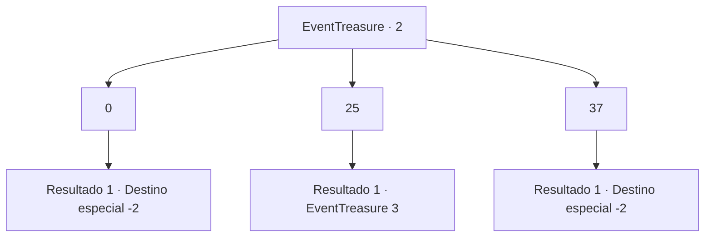

# Eventos de tesouro · 2

[Índice da tabela](index.md) · [Índice geral](../index.md)

ID: `pt:EventTreasure:2` · Fonte: `EventTreasure4` · Versão: 1.2.47.

Mapeamento estático dos arquivos; a disponibilidade e a execução dependem do estado da run.

## Texto do evento

*Sem texto no arquivo.*

## Dados de entrada

```json
{
  "id": 2,
  "grade": 1,
  "place": "",
  "required": ""
}
```

## Mapa das escolhas



## Escolhas e resultados

### Escolha 1

0

Requisitos e outros campos da escolha:

```json
{
  "required": ""
}
```

#### Resultado 1.1

Você caminha em direção a lápide com o número 0 escrito. Pouco depois de ir por um caminho estreito cheio de galhos e mato, você percebe que chegou ao outro lado.

Continuação registrada: [Destino especial `-2`](../destinos-especiais.md).

```json
{
  "required": "",
  "chance": "1",
  "nextEvent": -2,
  "type": 2,
  "reward": ""
}
```

### Escolha 2

25

Requisitos e outros campos da escolha:

```json
{
  "required": ""
}
```

#### Resultado 2.1

Você caminha em direção à lápide com o número 25 escrito nela. Logo após descer um caminho estreito cheio de galhos e grama, uma grande área aberta aparece. Lá, você encontra uma lápide de mármore bem cuidada. Ao se aproximar, uma luz brilhante emana dela e uma figura aparece. A silhueta transparente de um homem está te encarando. 

 "Preciso saber se você veio aqui sabendo quais são as minhas intenções. Aqui... Escolha."

 Então ele acena com a mão no ar. Seguindo seu movimento, padrões de animais aparecem.

Continuação registrada: [Evento 3](0003.md) na mesma tabela.

```json
{
  "required": "",
  "chance": "1",
  "nextEvent": 3,
  "type": 2,
  "reward": ""
}
```

### Escolha 3

37

Requisitos e outros campos da escolha:

```json
{
  "required": ""
}
```

#### Resultado 3.1

Você caminha em direção a lápide com o número 37 escrito. Pouco depois de ir por um caminho estreito cheio de galhos e mato, você percebe que chegou ao outro lado.

Continuação registrada: [Destino especial `-2`](../destinos-especiais.md).

```json
{
  "required": "",
  "chance": "1",
  "nextEvent": -2,
  "type": 2,
  "reward": ""
}
```

## Referências que chegam a este evento

- [Evento 1 · escolha 2 · resultado 1](0001.md#escolha-2)
